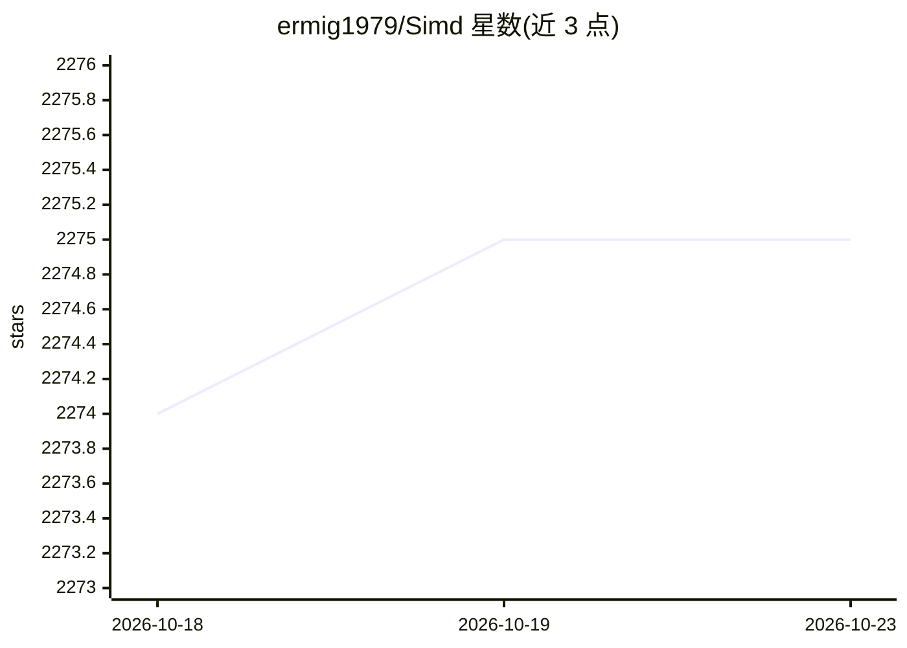

# ermig1979/Simd

⭐ 2,275 · C++ · MIT · 推送 2026-10-22 · [GitHub](https://github.com/ermig1979/Simd) · [官网](http://ermig1979.github.io/Simd) · 个人维护

**面向 C/C++ 的 SIMD 优化图像处理与机器学习库**

C/C++ 图像处理与机器学习库，提供像素格式转换、图像缩放滤波、统计信息提取、运动检测与神经网络等算法，并针对 SSE/AVX/AVX-512/AMX（x86/x64）、NEON/SVE/SVE2（ARM）等 SIMD CPU 扩展优化，支持运行时自动选择更快的指令集实现。同时提供 C API、C++ 封装类、Python wrapper，支持 Windows/Linux、MSVS/G++/Clang 与 CMake 构建，含测试框架、fuzzing 目标与 vcpkg 安装途径，另支持与 OpenCV 的类型互转。使用需自行从源码构建（或经 vcpkg 安装）。

## 筛选速览

| 维度 | 判定 | 备注 |
|---|---|---|
| AI 角色 | `ai-native` | 本体是模型或模型工具 |
| 许可风险 | `permissive` | MIT |
| 部署形态 | `None` |  |
| 模型依赖 | — | README 未给出锁定关系 |
| 硬件要求 | — | 无带数字的原话,不猜 |
| 安装摩擦 | `medium` | 含编译或系统依赖之一 |
| 成熟度 | — | 结构信号不足 |

## 能力要点

- 像素格式转换、缩放滤波、统计提取、运动检测、神经网络等算法
- 针对 SSE/AVX/AVX-512/AMX/NEON/SVE/SVE2 的 SIMD 优化与运行时算法选择
- 提供 C API、C++ 类封装与 Python wrapper
- 含测试框架、fuzzing 目标与 OpenCV 类型互转支持

## 适用场景

- 在 C/C++ 项目中集成高性能图像处理与神经网络推理
- 利用 CPU SIMD 扩展（含 AMX/SVE）加速图像算法
- 通过 vcpkg 或 CMake 在 Windows/Linux 上构建使用

## 场景标签

`图像视频处理` · 领域:感知与多模态

## 证据(README 行号)

> L3: The Simd Library is a free open source image processing and machine learning library, designed for C and C++ program
> L5: pixel format conversion, image scaling and filtration, extraction of statistic information from images, motion detec
> L8: The algorithms are optimized with using of different SIMD CPU extensions.

## 星数曲线

2026-10-18 2,274 → 2026-10-23 2,275（+1）

---
*卡片 v1 · prompt 1.4 · 生成 2026-10-21 · 置信度 high · 依据 README sha `da6fc444a754` · [字段定义](../../DATASET.md)*
