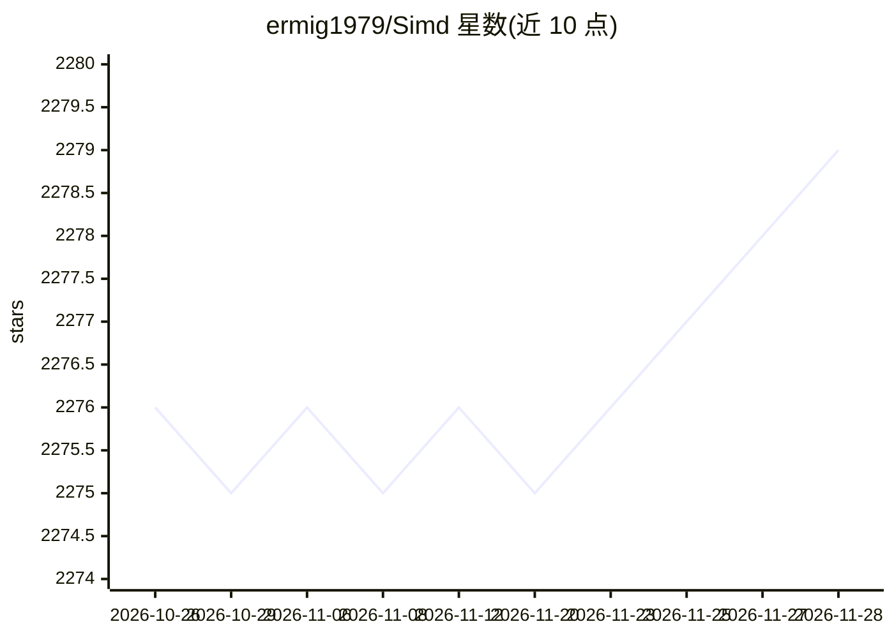

# ermig1979/Simd

⭐ 2,279 · C++ · MIT · 推送 2026-11-27 · [GitHub](https://github.com/ermig1979/Simd) · [官网](http://ermig1979.github.io/Simd) · 个人维护

**给 C/C++ 程序员的 SIMD 优化图像处理与机器学习库**

面向 C/C++ 程序员的开源图像处理与机器学习库，提供像素格式转换、图像缩放与滤波、统计信息提取、运动检测及神经网络等算法，并按 CPU 扩展（SSE/AVX/AVX-512/AMX、NEON/SVE/SVE2、HVX）优化。提供 C API 与 C++ 封装及 Python 包装；支持动态/静态链接、Windows/Linux 32/64 位、MSVS/G++/Clang，用 MSVS 项目或 CMake 从源码构建，也可经 vcpkg 安装。

## 筛选速览

| 维度 | 判定 | 备注 |
|---|---|---|
| AI 角色 | `ai-native` | 本体是模型或模型工具 |
| 许可风险 | `permissive` | MIT |
| 部署形态 | `None` |  |
| 模型依赖 | — | README 未给出锁定关系 |
| 硬件要求 | — | 无带数字的原话,不猜 |
| 安装摩擦 | `medium` | 含编译或系统依赖之一 |
| 成熟度 | — | 结构信号不足 |

## 能力要点

- 算法按 SIMD CPU 扩展优化，支持 x86/x64 与 ARM/Hexagon
- 提供 C API、C++ 类封装与 Python 包装
- 内置测试框架与 fuzzing 目标，可做正确性与性能测试
- 与 OpenCV 类型可互转（SIMD_OPENCV_ENABLE 宏）

## 适用场景

- 在 C++ 图像处理管线中用 SIMD 优化缩放、滤波等运算
- 实现视频运动检测
- 为神经网络推理加速做底层优化

## 场景标签

`图像视频处理` · 领域:感知与多模态

## 证据(README 行号)

> L3: The Simd Library is a free open source image processing and machine learning library, designed for C and C++ program
> L5: pixel format conversion, image scaling and filtration, extraction of statistic information from images, motion detec
> L6: neural network.

## 星数曲线

2026-10-26 2,276 → 2026-11-28 2,279（+3）

---
*卡片 v1 · prompt 1.4 · 生成 2026-11-23 · 置信度 high · 依据 README sha `cfb940250733` · [字段定义](../../DATASET.md)*
