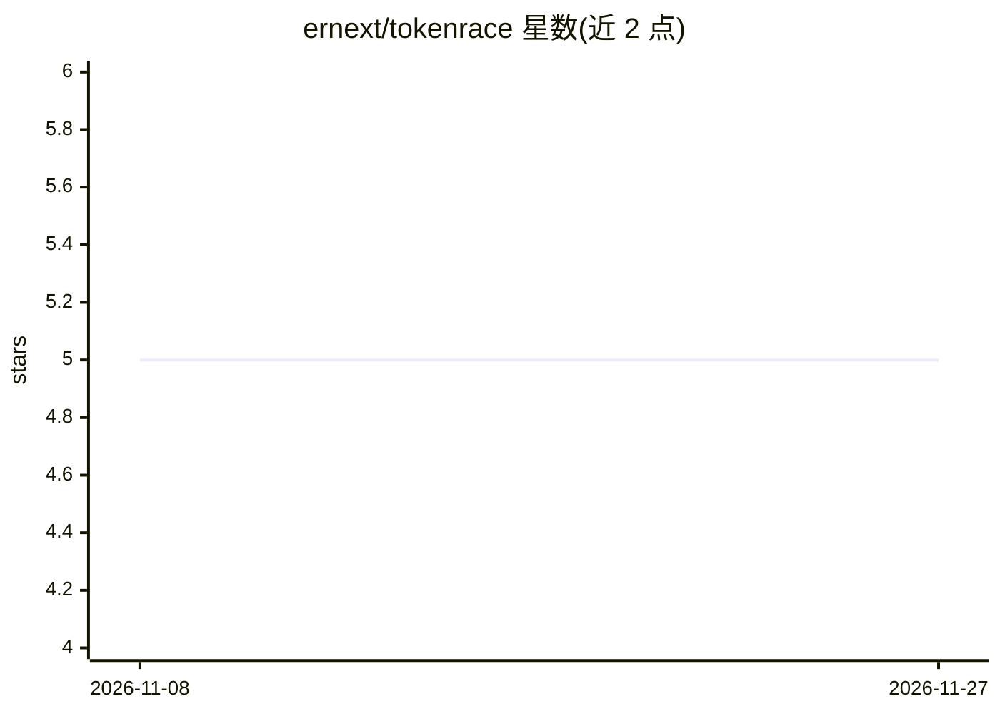

# ernext/tokenrace

⭐ 5 · Python · MIT · 推送 2026-11-25 · [GitHub](https://github.com/ernext/tokenrace) · 个人维护

**在本地硬件上以统一计时对比各本地 LLM 推理服务器的测速工具**

基于 Streamlit 的本地 LLM 推理速度测试应用：对 Ollama、LM Studio、llama.cpp、vLLM 等 OpenAI 兼容服务器使用相同的客户端计时代码，流式请求 POST /chat/completions，实时显示 TTFT、tokens/s、总时间与系统 RAM，输出中位数汇总、图表与 CSV 导出。区分推理 token 与回答 token，支持 No reasoning 开关；不安装或启动服务器，需用户自行运行；面向 Apple Silicon 构建，也可在 Linux/Windows 运行。

## 筛选速览

| 维度 | 判定 | 备注 |
|---|---|---|
| AI 角色 | `ai-ecosystem` | LLM/agent 周边工具 |
| 许可风险 | `permissive` | MIT |
| 部署形态 | `library` | 以包/库形式分发 |
| 模型依赖 | local-ok | 支持本地模型 |
| 硬件要求 | — | 无带数字的原话,不猜 |
| 安装摩擦 | `low` | 无编译、无系统依赖或容器化 |
| 成熟度 | — | 结构信号不足 |

## 能力要点

- 统一客户端计时（time.perf_counter），不使用服务器自身统计
- 实时指标：TTFT、tok/s、总时间、RAM，含汇总图表与 CSV 导出
- 推理/回答 token 区分与 No reasoning 开关，按服务器发送不同参数
- TOML 配置可添加服务器与新语言，界面支持英语/意大利语

## 适用场景

- 在购买/配置本地模型前先实测自己机器上的推理速度
- 对比不同推理服务器在同一模型与硬件下的延迟与吞吐
- 评估推理模型的 token 开销与可见回答速度

## 场景标签

`模型评测` · 领域:评测与运维

## 证据(README 行号)

> L13: An **LLM inference speed test**: compare local inference servers (Ollama, LM Studio, Rapid-MLX, oMLX, llama.cpp, vL
> L17: A small Streamlit app: pick a server and a model, start the test and watch TTFT, tokens per second, total time and 
> L87: ## Supported servers

## 星数曲线

2026-11-08 5 → 2026-11-27 5（+0）

---
*卡片 v1 · prompt 1.4 · 生成 2026-11-21 · 置信度 mid · 依据 README sha `9837c7c370f4` · [字段定义](../../DATASET.md)*
