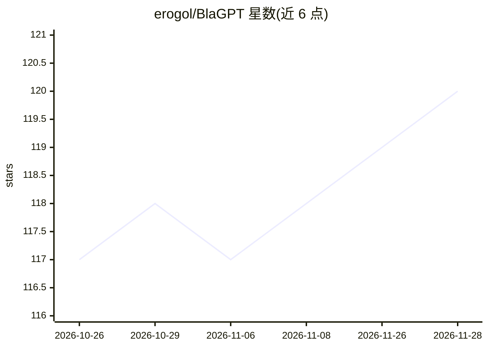

# erogol/BlaGPT

⭐ 120 · Python · 推送 2026-11-26 · [GitHub](https://github.com/erogol/BlaGPT) · 个人维护

**小预算下基准测试语言模型架构与训练技巧的实验场**

BlaGPT 是一个用于在小数据集/小预算上测试语言模型架构、层结构与训练技巧的实验代码库。核心机制是累积式基准：每项新改动叠加在当前最优配置上，仅当最终验证损失下降才保留；README 以表格记录各技术、替代架构、字节级模型与优化器的验证损失、峰值显存与每步耗时。提供 train.py（预分词数据）与 train_flex.py（自定义数据集/分词器/HuggingFace 流式）两个训练脚本、学习率查找器及模型注册接口。最佳配置运行在 8x H200 上，初始代码基于 NanoGPT 与 Modded NanoGPT。

## 筛选速览

| 维度 | 判定 | 备注 |
|---|---|---|
| AI 角色 | `ai-native` | 本体是模型或模型工具 |
| 许可风险 | `none` | — |
| 部署形态 | `None` |  |
| 模型依赖 | — | README 未给出锁定关系 |
| 硬件要求 | — | 无带数字的原话,不猜 |
| 安装摩擦 | `low` | 无编译、无系统依赖或容器化 |
| 成熟度 | — | 结构信号不足 |

## 能力要点

- 累积式基准流程：改动仅当验证损失下降才保留（✅/❌ 记录）
- 覆盖技术、替代架构、字节级模型、优化器四类实验表格，附显存与耗时
- train_flex.py 支持 HuggingFace 流式数据与自定义分词器
- 提供 @register_model 注册接口以添加新模型

## 适用场景

- 在小预算下对比不同的注意力与归一化技术
- 基准测试多种替代架构（RWKV、MegaByte、扩散 LM 等）
- 为自建模型快速接入统一的训练与评估流程
- 查找适合实验配置的学习率

## 场景标签

`模型评测` `模型训练` · 领域:评测与运维

## 证据(README 行号)

> L3: A playground to test language model architectures, layers and training tricks on a small budget.
> L4: Each new idea goes on top of the best config. It stays only if the final val loss drops.

## 星数曲线

2026-10-26 117 → 2026-11-28 120（+3）

---
*卡片 v1 · prompt 1.4 · 生成 2026-11-28 · 置信度 high · 依据 README sha `5f7dfbe5066c` · [字段定义](../../DATASET.md)*
