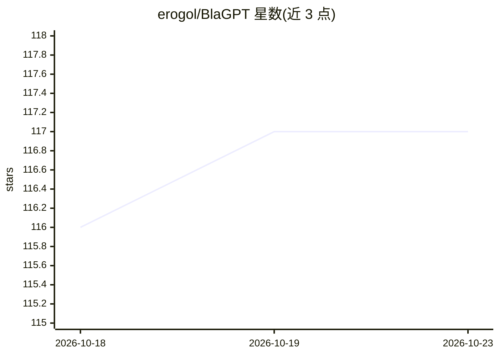

# erogol/BlaGPT

⭐ 117 · Python · 推送 2026-10-02 · [GitHub](https://github.com/erogol/BlaGPT) · 个人维护

**语言模型架构与训练技巧的小数据集实验对比框架**

面向 LM 架构研究者/爱好者的实验场：提供可配置的 Transformer 实现（各项技术可在 config 中开关），在小数据集上以贪婪架构搜索方式逐项叠加技术并记录验证 loss、显存与步时。已测 30 余种注意力/归一化/位置编码技术、10 余种其他模型架构（MegaByte、RWKV7、Hymba、LLaDa 等）、byte 级模型与 15 种优化器。提供 train.py/train_flex.py 两个训练脚本，支持二进制分片、HF 流式与 byte 级数据，并附 techniques/ 技术文档目录与添加新模型的注册流程。

## 筛选速览

| 维度 | 判定 | 备注 |
|---|---|---|
| AI 角色 | `ai-ecosystem` | LLM/agent 周边工具 |
| 许可风险 | `none` | — |
| 部署形态 | `None` |  |
| 模型依赖 | — | README 未给出锁定关系 |
| 硬件要求 | — | 无带数字的原话,不猜 |
| 安装摩擦 | `low` | 无编译、无系统依赖或容器化 |
| 成熟度 | `idea` | |

## 能力要点

- 30+ 种 LM 技术（注意力/归一化/位置编码/优化器）在统一框架下可配置开关并记录 loss/显存/步时
- 贪婪架构搜索：每项新技术叠加在当前最优配置上验证
- 支持 15+ 种优化器与 MegaByte/Hymba/RWKV7/LLaDa 等多种非标准架构
- 两个训练脚本支持二进制分片、HF 流式与 byte 级数据

## 适用场景

- 在小数据集上快速对比某种注意力或优化器技术对 loss 的影响
- 复现和验证论文中的架构技巧（RoVE、Differential Attention、Aurora 等）
- 以注册方式添加自定义模型架构进行训练实验

## 场景标签

`模型训练` · 领域:训练与推理

## 证据(README 行号)

> L3: Experimental playground for benchmarking language model (LM) architectures, layers, and tricks on smaller datasets. 
> L10: BlaGPT is a flexible Transformer implementation that you can turn on/off following things in the config.
> L12: I basically do a greedy architecture search and add every new technique on top of the best model config and see if 
> L193: BlaGPT provides two training scripts:

## 星数曲线

2026-10-18 116 → 2026-10-23 117（+1）

---
*卡片 v1 · prompt 1.4 · 生成 2026-10-23 · 置信度 high · 依据 README sha `e775d916035f` · [字段定义](../../DATASET.md)*
