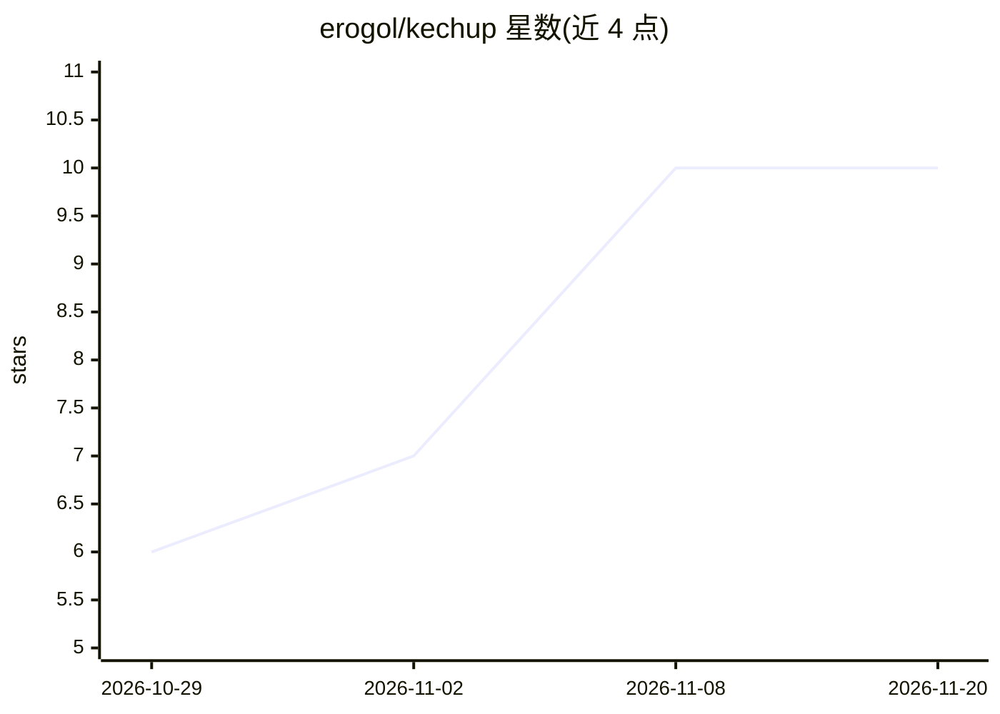

# erogol/kechup

⭐ 10 · Python · MIT · 推送 2026-10-27 · [GitHub](https://github.com/erogol/kechup) · 个人维护

**面向 AI agent 的项目任务 CLI：用 git 记录跨会话任务状态**

kechup 是一个针对单项目文件夹的命令行任务跟踪器，为 AI agent 及其使用者设计，解决新 agent 会话不知道上一会话做了什么的问题。任务、认领、备注与历史保存在项目文件夹内的 .kechup/tasks.json、keche.md 的 Work 区块和 git 提交中；每次写入生成一条以 agent ID 为作者的 git 提交。仅依赖 Python 标准库与 git 命令，无服务器、数据库、账号、网络与 API key。关闭任务需提交 REPORT.md 作为证据；git revert 被追踪并使依赖任务重新阻塞；文件锁防止多 agent 认领同一任务；所有命令支持 --json 与稳定退出码。不支持 Windows。

## 筛选速览

| 维度 | 判定 | 备注 |
|---|---|---|
| AI 角色 | `ai-ecosystem` | LLM/agent 周边工具 |
| 许可风险 | `permissive` | MIT |
| 部署形态 | `library` | 以包/库形式分发 |
| 模型依赖 | — | README 未给出锁定关系 |
| 硬件要求 | — | 无带数字的原话,不猜 |
| 安装摩擦 | `low` | 无编译、无系统依赖或容器化 |
| 成熟度 | — | 结构信号不足 |

## 能力要点

- 仅依赖 Python 标准库与 git，无需服务器、数据库、账号、网络或 API key
- 每次写入为一条 git 提交，agent ID 作为作者；git revert 被识别并触发任务重开/阻塞
- 多 agent 并发：文件锁防止重复认领，认领超 24 小时标记 stale
- 全命令支持 --json 与稳定错误码，提供 agent 指南与 SKILL.md 接入文件

## 适用场景

- 让多个 coding agent 在同一项目中交接任务并保留完整历史
- 在锁定服务器或沙箱环境中跟踪 agent 完成的工作
- 用 git log/blame/revert 审查 agent 的工作记录

## 场景标签

`多智能体` `编码 Agent` · 领域:Agent 开发

## 证据(README 行号)

> L9: kechup is a command-line task tracker for one project folder, made for AI agents and the people who run them.
> L11: The problem: a new agent session does not know what the last session did. kechup keeps the tasks, claims, notes and
> L26: kechup uses the Python standard library and the `git` command. It has no other dependencies.

## 星数曲线

2026-10-29 6 → 2026-11-20 10（+4）

---
*卡片 v1 · prompt 1.4 · 生成 2026-11-19 · 置信度 high · 依据 README sha `d5c147c20e64` · [字段定义](../../DATASET.md)*
