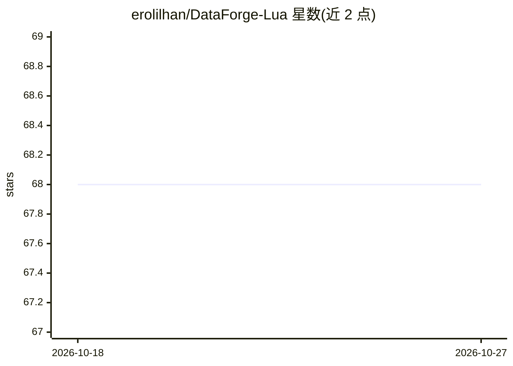

# erolilhan/DataForge-Lua

⭐ 68 · HTML · 推送 2026-10-26 · [GitHub](https://github.com/erolilhan/DataForge-Lua) · 个人维护

**纯 Lua 编写的机器学习/强化学习模型库，含 120+ 模型**

以纯 Lua 实现的机器学习框架（自称 DataPredict Nexus），提供 120 余个学习模型，覆盖线性/树/核方法、神经网络、序列模型、注意力结构、生成模型及值/策略型强化学习与多智能体方法。包含可运行于 Roblox、LÖVE、Defold、OpenResty 或 LuaJIT 沙盒的纯 Lua 推理内核、序列化导出格式、协程训练管道、浏览器 Playground 界面与插件桥接协议。README 未给出具体安装命令，示例代码位于 examples 目录。

## 筛选速览

| 维度 | 判定 | 备注 |
|---|---|---|
| AI 角色 | `ai-native` | 本体是模型或模型工具 |
| 许可风险 | `none` | — |
| 部署形态 | `None` |  |
| 模型依赖 | — | README 未给出锁定关系 |
| 硬件要求 | — | 无带数字的原话,不猜 |
| 安装摩擦 | `low` | 无编译、无系统依赖或容器化 |
| 成熟度 | — | 结构信号不足 |

## 能力要点

- 120+ 模型覆盖监督学习、深度学习与强化学习（含多智能体）
- 纯 Lua 推理内核，可运行于 Roblox/LÖVE/Defold/OpenResty/LuaJIT 沙盒
- 版本化二进制模型序列化格式，面向受限设备
- 协程训练管道与浏览器 Playground 实验界面

## 适用场景

- 在 Roblox 或 LÖVE 等游戏引擎内直接训练和部署模型
- 在嵌入式 LuaJIT 网关上做在线回归或异常检测
- 用纯 Lua 做多智能体强化学习仿真实验

## 场景标签

`强化学习` · 领域:训练与推理

## 证据(README 行号)

> L4: # 🧠 DataPredict Nexus — Adaptive Intelligence Runtime for Lua
> L28: - A **portable inference kernel** written in pure Lua, so your trained intellect can travel to Roblox, LÖVE, Defold
> L45: - **🧠 120+ Learning Models** — spanning classical regression, tree ensembles, kernel methods, neural architectures,

## 星数曲线

2026-10-18 68 → 2026-10-27 68（+0）

---
*卡片 v1 · prompt 1.4 · 生成 2026-10-24 · 置信度 mid · 依据 README sha `ceb564839de6` · [字段定义](../../DATASET.md)*
