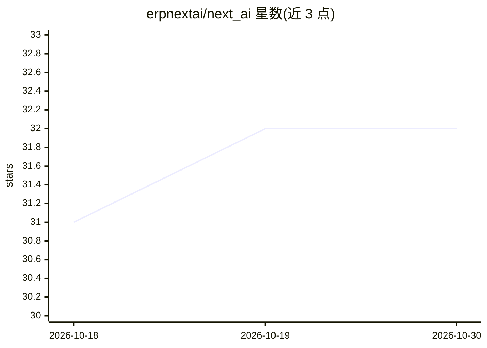

# erpnextai/next_ai

⭐ 32 · Python · NOASSERTION · 推送 2026-08-11 · [GitHub](https://github.com/erpnextai/next_ai) · [官网](https://www.erpnextai.in) · 组织维护

**为 ERPNext/Frappe 接入 Gemini 的内容生成扩展应用**

Frappe 定制应用，将 Google Gemini LLM 接入 ERPNext：在文本编辑器字段中提供 NextAI 按钮，按用户提示生成条款、政策等正式文档，支持语法纠正、内容改写与上下文增强。支持 Markdown/Text/HTML/Code 等 6 种字段类型与 Frappe v14/v15。配置需在 NextAI Settings 填入 API key 并选择模型与平台，用户需 System Manager 或 NextAI User 角色。目前仅支持 Gemini，计划支持 ChatGPT 与 GROQ。

## 筛选速览

| 维度 | 判定 | 备注 |
|---|---|---|
| AI 角色 | `ai-enhanced` | 去掉 AI 部分产品仍成立 |
| 许可风险 | `none` | NOASSERTION |
| 部署形态 | `None` |  |
| 模型依赖 | — | README 未给出锁定关系 |
| 硬件要求 | — | 无带数字的原话,不猜 |
| 安装摩擦 | `low` | 无编译、无系统依赖或容器化 |
| 成熟度 | — | 结构信号不足 |

## 能力要点

- 在 ERPNext 文本编辑器字段内按提示生成正式文档
- 实时语法纠正与上下文内容增强
- 支持 Markdown/Small Text/Long Text/HTML/Text Editor/Code 六种字段类型
- 兼容 Frappe v14 与 v15，通过 doctype 配置 API key 与模型

## 适用场景

- 在 ERPNext 内直接起草条款、政策等文档，无需切换外部工具
- 对 ERP 中的文本字段做语法纠正与润色
- 为 ERPNext 系统用户统一配置 Gemini 生成能力

## 场景标签

`AI 写作` · 领域:内容生成

## 证据(README 行号)

> L4: **NextAI** is a custom Frappe app that seamlessly integrates with Google's **Gemini LLM models** to bring powerful A
> L27: 1. Navigate to any text editor field where AI content is needed.
> L31: 5. The AI-generated content will be inserted into the field based on your prompt.

## 星数曲线

2026-10-18 31 → 2026-10-30 32（+1）

---
*卡片 v1 · prompt 1.4 · 生成 2026-10-26 · 置信度 high · 依据 README sha `e150f770138f` · [字段定义](../../DATASET.md)*
