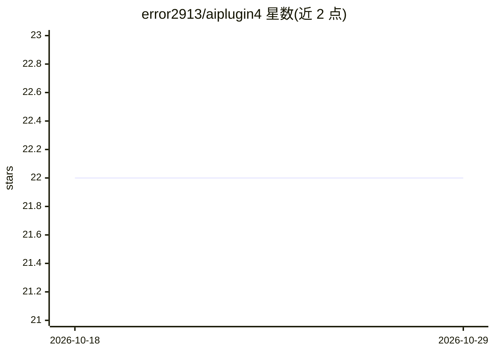

# error2913/aiplugin4

⭐ 22 · TypeScript · MIT · 推送 2026-10-28 · [GitHub](https://github.com/error2913/aiplugin4) · 个人维护 · 中文 README

**SealDice 骰娘的 AI 对话插件，接入大模型 API 扮演 TRPG 角色**

运行在 SealDice（海豹骰子）上的 JS 插件，通过 OpenAI 兼容 API 接入大模型，为 QQ 等 IM 里的骰娘提供上下文对话、角色设定、长期记忆（向量检索）、知识库与图片识别。内置 40+ 工具函数覆盖 TRPG 检定、牌堆、禁言、定时器等，支持函数调用与 MCP 外部服务器接入。模型配置用 JSON 声明多连接（文本/视觉/嵌入/生图/语音），deepseek 出厂默认，anthropic-messages 协议自动转换（流式暂不支持）。面向 TRPG 玩家群与骰主，需 SealDice v1.4.6+ 与大模型 API。

## 筛选速览

| 维度 | 判定 | 备注 |
|---|---|---|
| AI 角色 | `ai-native` | 本体是模型或模型工具 |
| 许可风险 | `permissive` | MIT |
| 部署形态 | `library` | 以包/库形式分发 |
| 模型依赖 | locked-api |  |
| 硬件要求 | — | 无带数字的原话,不猜 |
| 安装摩擦 | `low` | 无编译、无系统依赖或容器化 |
| 成熟度 | — | 结构信号不足 |

## 能力要点

- OpenAI 兼容多连接模型配置，按用途（对话/压缩/摘要/判定等）绑定与故障切换
- 内置 40+ TRPG 工具函数，支持函数调用、提示词工程与外部 MCP 服务器
- 长期记忆（向量检索+标签过滤）、观察记忆与 JSON 配置知识库
- 多智能体子代理委派与跨平台会话目录、token 用量统计与工具调用审计

## 适用场景

- 让跑团群里的骰娘用 AI 扮演 NPC 或主持对话
- 给骰娘配置角色设定、长期记忆与群知识库
- 通过自然语言让骰娘执行检定、牌堆等 TRPG 操作

## 场景标签

`聊天机器人` · 领域:对话与助手

## 证据(README 行号)

> L61: AI骰娘4 是一款运行在 SealDice 上的智能对话插件，基于 OpenAI 兼容 API 开发，深度整合海豹骰子生态的 TRPG 功能：
> L63: - **智能对话**：支持上下文感知的 AI 对话、角色设定与预设上下文（示例对话）；

## 星数曲线

2026-10-18 22 → 2026-10-29 22（+0）

---
*卡片 v1 · prompt 1.4 · 生成 2026-10-27 · 置信度 high · 依据 README sha `fdec700cab4f` · [字段定义](../../DATASET.md)*
