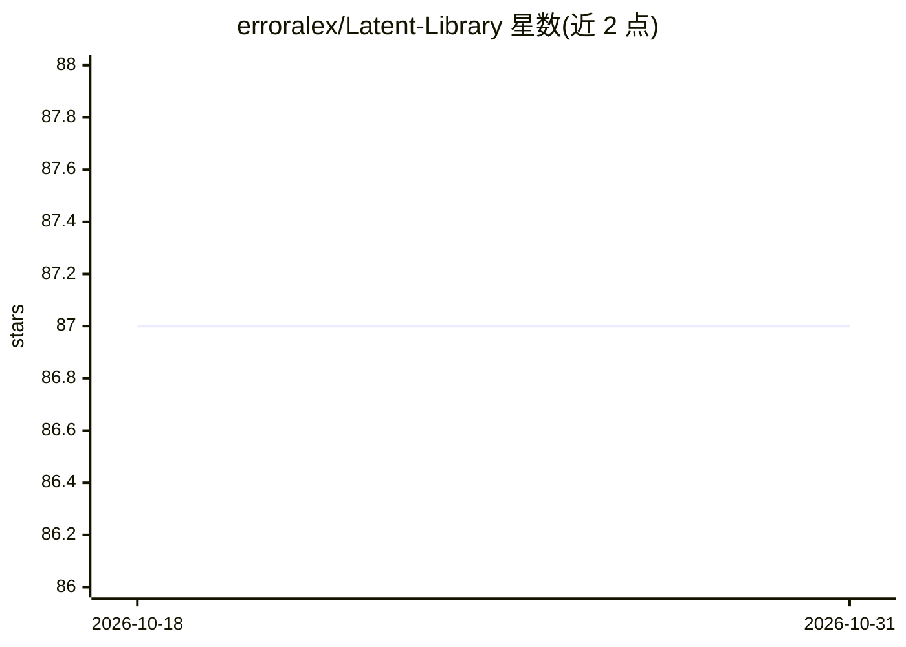

# erroralex/Latent-Library

⭐ 87 · Java · NOASSERTION · 推送 2026-08-24 · [GitHub](https://github.com/erroralex/Latent-Library) · [官网](https://github.com/erroralex/Latent-Library/releases) · 个人维护

**面向 AI 生成图像的本地优先桌面素材管理器**

本地优先的桌面图像素材管理应用，面向 AI 图像生成生态的创作者：统一解析 ComfyUI/Automatic1111/Forge/InvokeAI/SwarmUI/NovelAI 等格式的嵌入元数据，提供 SQLite FTS5 全文检索、Smart Collections 动态集合、实时文件夹监听、重复图像检测与元数据清洗（分享前剥离 prompt/工作流）。AI 部分为内置 WD14 ONNX 模型的本地自动打标签，CPU 运行、无需 GPU，无云端调用。技术栈为 Java 21 + Spring Boot 后端 + Vue 3 前端，Electron 打包为 Windows/Linux/macOS 便携单文件应用，自带 Java 运行时。许可为 MIT + Commons Clause（限制销售）。macOS 未签名需手动清除隔离属性。

## 筛选速览

| 维度 | 判定 | 备注 |
|---|---|---|
| AI 角色 | `ai-enhanced` | 去掉 AI 部分产品仍成立 |
| 许可风险 | `none` | NOASSERTION |
| 部署形态 | `desktop` | 安装包/桌面程序 |
| 模型依赖 | — | README 未给出锁定关系 |
| 硬件要求 | — | 无带数字的原话,不猜 |
| 安装摩擦 | `medium` | 含编译或系统依赖之一 |
| 成熟度 | — | 结构信号不足 |

## 能力要点

- 统一解析 ComfyUI/A1111/Forge/InvokeAI/SwarmUI/NovelAI 等生成器元数据
- SQLite FTS5 全文检索与虚拟滚动，支持数万张图像库
- 内置 WD14 ONNX 模型本地自动打标签，CPU 运行无需 GPU
- Metadata Scrubber 分享前剥离 EXIF/prompt/工作流数据，100% 离线无遥测

## 适用场景

- 管理大量 AI 生成图像并按模型/采样器/LoRA/标签过滤检索
- 一边生成一边实时收录 ComfyUI/A1111 输出文件夹的新图
- 分享图像前清洗隐藏的 prompt 与工作流元数据
- 批量整理生成结果：评分、快捷键归类、查重

## 场景标签

 · 领域:AI 图像生成/素材管理

## 证据(README 行号)

> L12: A high-performance desktop asset manager built for the AI image generation ecosystem. It unifies metadata parsing a
> L69: * **AI Auto-Tagger:** Integrated **WD14 ONNX** model for local image interrogation. Automatically generate descript

## 星数曲线

2026-10-18 87 → 2026-10-31 87（+0）

---
*卡片 v1 · prompt 1.4 · 生成 2026-10-23 · 置信度 high · 依据 README sha `450b2227477f` · [字段定义](../../DATASET.md)*
