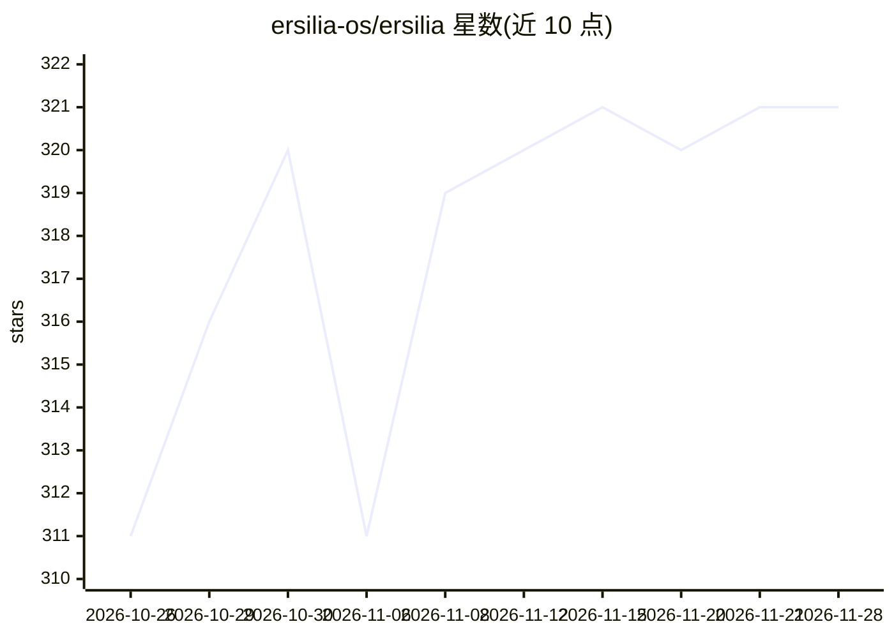

# ersilia-os/ersilia

⭐ 321 · Python · GPL-3.0 · 推送 2026-11-26 · [GitHub](https://github.com/ersilia-os/ersilia) · [官网](https://ersilia.io) · 组织维护

**面向传染病与被忽视疾病研究的预训练 AI/ML 模型库与 CLI**

Ersilia Model Hub 提供一个统一平台，收录用于传染病与被忽视疾病研究及药物发现的预训练 AI/ML 模型，来源包括文献发表模型与团队自研模型。核心交付物是 Ersilia CLI 与 Python API：用户通过 fetch/serve/run/close/delete 等命令获取并运行模型，输入 CSV 输出预测结果；每个模型独立打包在自己的环境中，可选 Conda 源码打包或 Docker 容器方式。安装需要 Python 3.10 的 Conda 环境，支持 PyPI 安装或从源码克隆。维护方为非营利组织 Ersilia Open Source Initiative，采用 GPL-3 许可。

## 筛选速览

| 维度 | 判定 | 备注 |
|---|---|---|
| AI 角色 | `ai-ecosystem` | LLM/agent 周边工具 |
| 许可风险 | `viral` | GPL-3.0 |
| 部署形态 | `library` | 以包/库形式分发 |
| 模型依赖 | — | README 未给出锁定关系 |
| 硬件要求 | — | 无带数字的原话,不猜 |
| 安装摩擦 | `low` | 无编译、无系统依赖或容器化 |
| 成熟度 | — | 结构信号不足 |

## 能力要点

- CLI 提供 catalog/fetch/serve/run/close/delete 等模型全流程命令
- 每个模型独立打包，支持 Conda 源码或 Docker 容器两种打包方式
- CLI 命令与 Python API（Model/Catalog 类）行为一致
- 模型覆盖抗生素活性预测、ADMET 预测、分子表征、生成化学等方向

## 适用场景

- 查找并运行抗生素活性或 ADMET 预测模型对分子做批量预测
- 在传染病药物发现项目中接入公开发表的预训练模型
- 通过 Python API 将模型运行集成到自动化脚本或 CI 流程

## 场景标签

`科研工具` · 领域:学习与行业

## 证据(README 行号)

> L15: The Ersilia Model Hub is a unified platform of pre-trained AI/ML models for 🦠 infectious and neglected disease rese
> L33: 1. You need to install the Ersilia CLI. This is the central tool to manage models in the Ersilia Model Hub.
> L61: To **install each model**, you have two options. You can either package them from source, in which case only Conda 

## 星数曲线

2026-10-26 311 → 2026-11-28 321（+10）

---
*卡片 v1 · prompt 1.4 · 生成 2026-11-25 · 置信度 high · 依据 README sha `8d6ad560feab` · [字段定义](../../DATASET.md)*
