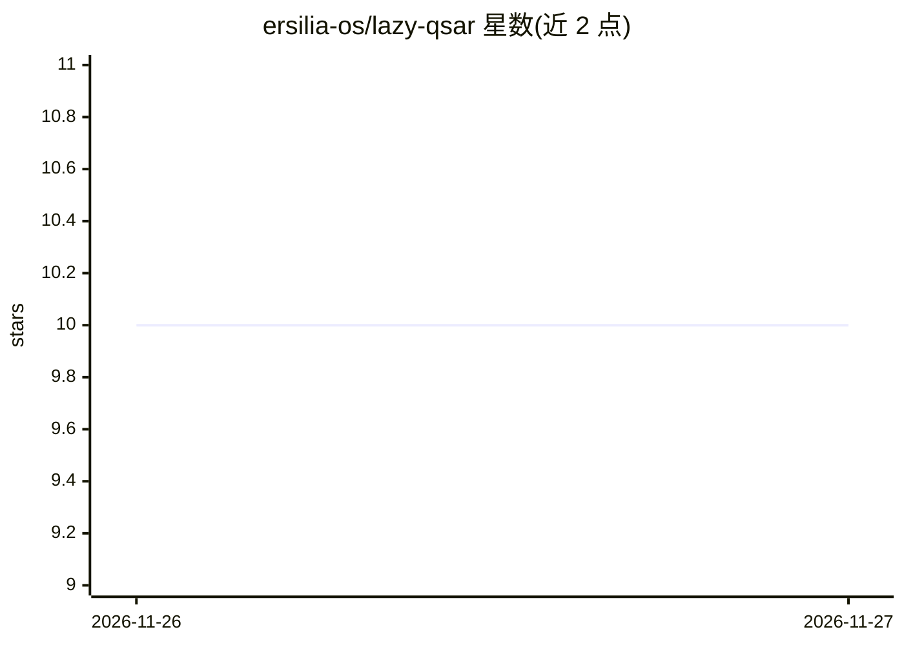

# ersilia-os/lazy-qsar

⭐ 10 · Python · GPL-3.0 · 推送 2026-11-26 · [GitHub](https://github.com/ersilia-os/lazy-qsar) · 组织维护

**少配置快速构建监督 QSAR 模型的 Python 库**

面向化学信息学与药物发现的建模库：输入 SMILES 或自备描述符，自动完成分子描述符计算与模型选择，产出性质/活性预测模型。分类支持 fast（Morgan 指纹）与 slow（CDDD/Chemeleon/CLAMP/RDKit）两种描述符模式；回归用 ridge/XGBoost/随机森林/SVR 头经 stacking 混合并给 split-conformal 预测区间。模型以 ONNX 保存，推理只需 numpy 与 onnxruntime。相对 50,000 分子的参考库输出 rank 指标；多类别错误输入会显式拒绝而非返回数值。源码安装，可选 fit/descriptors extras。

## 筛选速览

| 维度 | 判定 | 备注 |
|---|---|---|
| AI 角色 | `ai-native` | 本体是模型或模型工具 |
| 许可风险 | `viral` | GPL-3.0 |
| 部署形态 | `library` | 以包/库形式分发 |
| 模型依赖 | — | README 未给出锁定关系 |
| 硬件要求 | `cpu-ok` | |
| 安装摩擦 | `medium` | 含编译或系统依赖之一 |
| 成熟度 | — | 结构信号不足 |

## 能力要点

- 输入 SMILES 自动计算描述符与模型选择，fast/slow 两种模式
- 模型保存为 ONNX，推理仅需 numpy 与 onnxruntime
- 回归头 stacking 混合并输出 conformal 预测区间
- predict_rank 相对 50,000 药类分子参考库定位分子

## 适用场景

- 为化合物性质/活性快速建立分类或回归 QSAR 模型
- 用预测区间与适用域评分筛选候选分子
- 部署轻量 ONNX 模型做性质预测推理

## 场景标签

`科研工具` · 领域:学习与行业

## 证据(README 行号)

> L5: A Python library for building supervised QSAR models quickly, with minimal configuration. LazyQSAR automates chemica
> L182: - **Heads** are linear (ridge), XGBoost, random forest and SVR, each with one preset chosen on a regression benchm

## 星数曲线

2026-11-26 10 → 2026-11-27 10（+0）

---
*卡片 v1 · prompt 1.4 · 生成 2026-11-26 · 置信度 high · 依据 README sha `019971441d45` · [字段定义](../../DATASET.md)*
