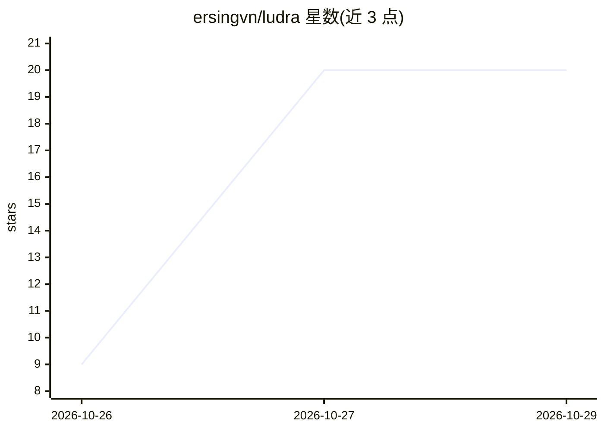

# ersingvn/ludra

⭐ 20 · TypeScript · MIT · 推送 2026-10-25 · [GitHub](https://github.com/ersingvn/ludra) · 个人维护

**面向 AI agent 的 2D/3D 游戏引擎：JSON 场景+无头试玩与测试**

TypeScript 游戏引擎，设计目标是被 AI agent（如 Claude Code 插件）直接驱动开发游戏：场景为纯 JSON（实体+组件），无编辑器与二进制文件；ludra check 为每条诊断给出 JSON 路径与具体修复建议；ludra play 提供确定性无头仿真、事件时间线、ASCII 帧图与真实渲染 PNG 截图；ludra test 用脚本化输入加断言证明关卡可通关；ludra review 标记未完成内容；ludra dev 在浏览器中供人游玩。物理支持 arcade 与 Rapier（确定性构建），提供 Claude Code 插件安装方式与 npm/源码安装。自述处于早期版本 v0.91。

## 筛选速览

| 维度 | 判定 | 备注 |
|---|---|---|
| AI 角色 | `ai-ecosystem` | LLM/agent 周边工具 |
| 许可风险 | `permissive` | MIT |
| 部署形态 | `library` | 以包/库形式分发 |
| 模型依赖 | — | README 未给出锁定关系 |
| 硬件要求 | — | 无带数字的原话,不猜 |
| 安装摩擦 | `low` | 无编译、无系统依赖或容器化 |
| 成熟度 | `idea` | |

## 能力要点

- 场景为纯 JSON，无编辑器，agent 可直接读写
- 确定性无头仿真：ludra play 输出时间线、事件与真实渲染截图
- ludra test 脚本化输入加断言（won/deaths/score 等）验证关卡
- ludra check 每条诊断附 JSON 路径与 fix 建议

## 适用场景

- 让 Claude 等 agent 从零构建并自测平台跳跃等类型游戏
- CI 中用 ludra test/review --strict 验证游戏可玩且完成
- 用浏览器端 ludra dev 交接给人游玩与实时调整

## 场景标签

 · 领域:游戏开发/AI agent 工具

## 证据(README 行号)

> L13: Unity, Unreal and Godot are designed for humans clicking around an editor. Ludra is designed for an agent like Clau
> L41: |A format it can read and write reliably|Scenes are JSON: entities made of components. No binary files, no editor.|
> L15: You describe the game. The agent builds it with Ludra, checks it, plays it, tests it and hands it to you.

## 星数曲线

2026-10-26 9 → 2026-10-29 20（+11）

---
*卡片 v1 · prompt 1.4 · 生成 2026-10-28 · 置信度 high · 依据 README sha `d5deda8e662b` · [字段定义](../../DATASET.md)*
