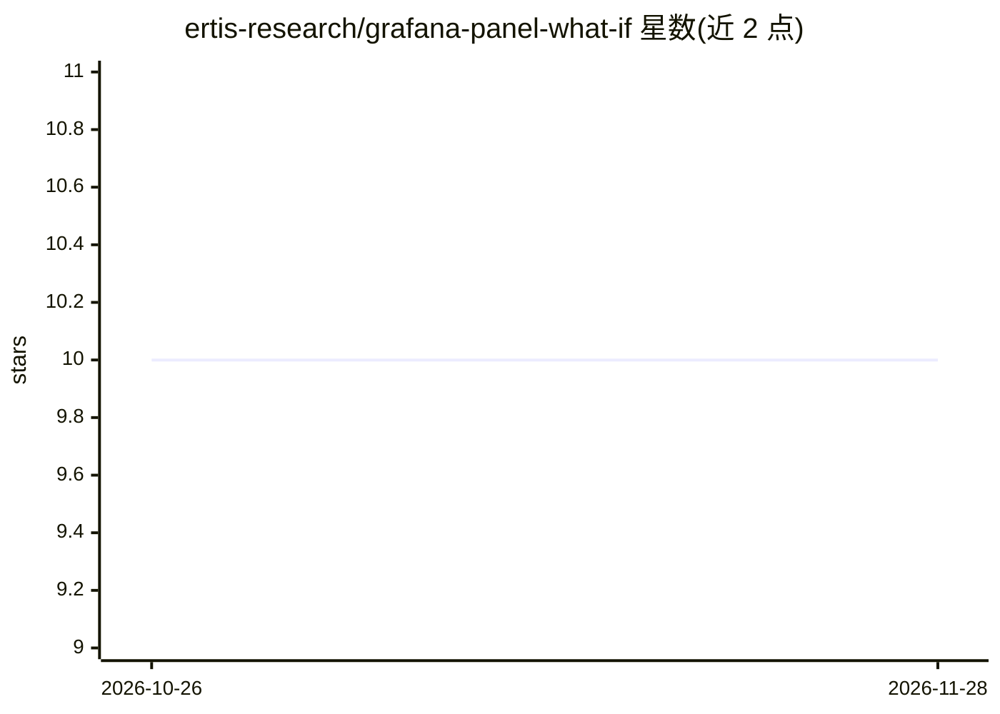

# ertis-research/grafana-panel-what-if

⭐ 10 · TypeScript · Apache-2.0 · 推送 2026-07-28 · [GitHub](https://github.com/ertis-research/grafana-panel-what-if) · 组织维护

**Grafana 面板插件：对 ML 模型做 What-If 预测分析**

Grafana 应用插件，对接通过 HTTP 接收数值字段的 AI/ML 模型，执行 What-If 预测分析。工作流分五步：选择模型、导入数据（指定时间、CSV 或面板变量）、修改数据（直接改值、设置区间或两者混合）、执行预测并展示原值/新值/对比图、可选导出 CSV。支持多个数据集合同时用同一模型预测，提供标签分类过滤、文本搜索与区间对比。要求 Grafana ≥8，插件未签名，需加入 allow_loading_unsigned_plugins 列表。

## 筛选速览

| 维度 | 判定 | 备注 |
|---|---|---|
| AI 角色 | `ai-native` | 本体是模型或模型工具 |
| 许可风险 | `permissive` | Apache-2.0 |
| 部署形态 | `library` | 以包/库形式分发 |
| 模型依赖 | — | README 未给出锁定关系 |
| 硬件要求 | — | 无带数字的原话,不猜 |
| 安装摩擦 | `low` | 无编译、无系统依赖或容器化 |
| 成熟度 | — | 结构信号不足 |

## 能力要点

- 对接经 HTTP 接收数值字段列表的 AI/ML 模型进行 What-If 预测
- 三种数据修改方式：直接改值、区间分析、两者混合叠加
- 支持多数据集合同时以同一模型预测并对比结果
- 从 Grafana 数据源直接加载数据，支持 CSV 导入导出

## 适用场景

- 在监控面板中调整特征值后查看模型预测的变化
- 对某标签的取值区间做逐点预测并绘制对比曲线
- 导入 CSV 数据离线分析模型的 What-If 行为并导出结果

## 场景标签

 · 领域:可观测性/ML 可视化分析

## 证据(README 行号)

> L8: This Grafana panel is a powerful tool for conducting **What-If predictive analysis with Artificial Intelligence mode
> L10: The tool enables easy loading of data into the model directly from a data source configured in Grafana. It allows d
> L85: To begin, the AI/ML model to be used to perform the analysis must be selected. Once chosen, the tags associated wit

## 星数曲线

2026-10-26 10 → 2026-11-28 10（+0）

---
*卡片 v1 · prompt 1.4 · 生成 2026-11-19 · 置信度 high · 依据 README sha `20d7add77119` · [字段定义](../../DATASET.md)*
