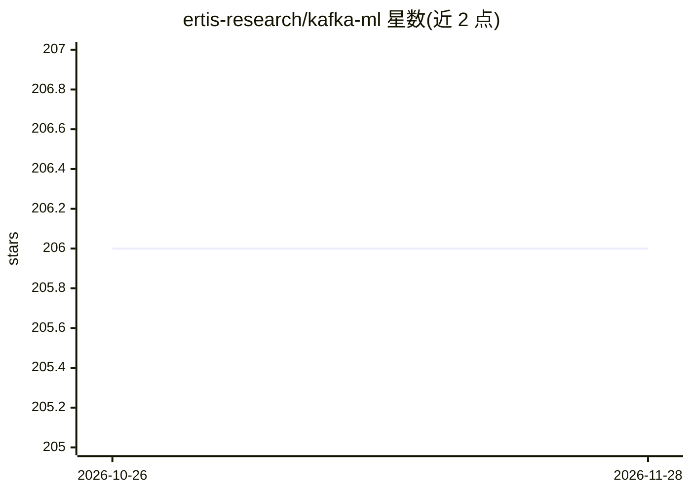

# ertis-research/kafka-ml

⭐ 206 · Python · MIT · 推送 2026-11-04 · [GitHub](https://github.com/ertis-research/kafka-ml) · 组织维护

**面向 ML 从业者的 Kafka 数据流驱动的 Kubernetes 模型训练推理流水线**

在 Kubernetes 上管理 TensorFlow/Keras 与 PyTorch(Ignite) 模型流水线的框架，覆盖模型设计、训练与推理。训练与推理数据集通过 Apache Kafka 输入，可对接 IoT 等数据流；模型在 Web UI 中以 TF/Keras 或 PyTorch 源码定义，无需本地装库执行。支持单模型与分布式多子模型（Edge-Fog-Cloud 链条），提供训练指标与混淆矩阵可视化、训练模型下载、按副本数部署推理并经 Kafka topic 输出预测。部署依赖 Docker 与 Kubernetes(v1.15.5+)。

## 筛选速览

| 维度 | 判定 | 备注 |
|---|---|---|
| AI 角色 | `ai-ecosystem` | LLM/agent 周边工具 |
| 许可风险 | `permissive` | MIT |
| 部署形态 | `self-host` | docker 或自建部署 |
| 模型依赖 | — | README 未给出锁定关系 |
| 硬件要求 | `cpu-ok` | |
| 安装摩擦 | `low` | 无编译、无系统依赖或容器化 |
| 成熟度 | — | 结构信号不足 |

## 能力要点

- Web UI 中以源码定义 TF/Keras 与 PyTorch 模型并组队训练
- 通过 Apache Kafka topic 输入训练/推理数据流（Avro 与 Raw 两种 sink）
- 支持 Edge-Fog-Cloud 式分布式多子模型层级定义
- 训练指标/混淆矩阵可视化，JSON 导出与推理结果可视化

## 适用场景

- 把 IoT 设备产生的数据流接入模型训练与推理
- 在 Kubernetes 上部署多副本模型推理服务并消费 Kafka topic
- 在 Web UI 里对比一组模型的 loss/accuracy 训练指标
- 构建边缘-雾-云分层的分布式推理链

## 场景标签

`模型训练` `MLOps` `推理引擎` · 领域:训练与推理

## 证据(README 行号)

> L3: Kafka-ML is a framework to manage the pipeline of Tensorflow/Keras and PyTorch
> L6: datasets for the ML models can be fed through Apache Kafka, thus they can be
> L43: - Docker

## 星数曲线

2026-10-26 206 → 2026-11-28 206（+0）

---
*卡片 v1 · prompt 1.4 · 生成 2026-11-25 · 置信度 mid · 依据 README sha `c176a07e1a03` · [字段定义](../../DATASET.md)*
