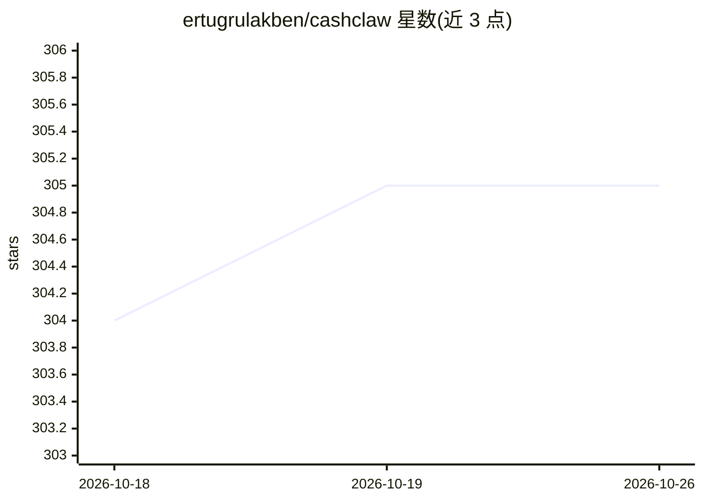

# ertugrulakben/cashclaw

⭐ 305 · JavaScript · MIT · 推送 2026-10-06 · [GitHub](https://github.com/ertugrulakben/cashclaw) · [官网](https://cashclawai.com) · 个人维护

**OpenClaw 技能包：让 AI agent 在 HYRVE 市场上接单赚钱并收款**

CashClaw 是一套 13 个 OpenClaw 兼容技能包，插入任意 OpenClaw 型 agent 后使其具备销售与交付数字服务的能力：SEO 审计、内容写作、线索生成、爬取、发票与 Stripe 收款等。通过 50+ 函数的 hyrve-bridge 连接 HYRVE AI 市场（接单、托管收款、85% 分成、USDC 的 MPP 机器支付），附带 Guard 运行时防护（硬成本上限、递归终止、工具防火墙）与任务审计追踪。以 npx/npm 安装的 CLI 形式提供。

## 筛选速览

| 维度 | 判定 | 备注 |
|---|---|---|
| AI 角色 | `ai-ecosystem` | LLM/agent 周边工具 |
| 许可风险 | `permissive` | MIT |
| 部署形态 | `library` | 以包/库形式分发 |
| 模型依赖 | — | README 未给出锁定关系 |
| 硬件要求 | — | 无带数字的原话,不猜 |
| 安装摩擦 | `low` | 无编译、无系统依赖或容器化 |
| 成熟度 | `idea` | |

## 能力要点

- 13 个技能包（Guard、SEO、内容、线索、发票等）插入 OpenClaw 兼容 agent
- Guard 运行时防护：硬成本上限、递归终止、工具防火墙、YAML 策略
- HYRVE bridge 50+ API 函数覆盖认证、订单、钱包、支付、管理
- 支持 Stripe Machine Payments Protocol（USDC 的 agent 间支付）

## 适用场景

- 让自主 agent 在 HYRVE 市场自动接单、交付并收款
- 给无人值守的 agent 加运行时成本与递归防护
- 追踪每个任务的完整审计记录用于客户对账

## 场景标签

`Agent 框架` `AI 写作` `网页抓取` · 领域:Agent 开发

## 证据(README 行号)

> L38: CashClaw is a set of **OpenClaw skills** that turn your AI agent into a freelance business operator -- now connecte
> L44: It is not a framework. It is not a SaaS dashboard. It is a skill pack that plugs into any OpenClaw-compatible agent

## 星数曲线

2026-10-18 304 → 2026-10-26 305（+1）

---
*卡片 v1 · prompt 1.4 · 生成 2026-10-21 · 置信度 high · 依据 README sha `090370b10c82` · [字段定义](../../DATASET.md)*
