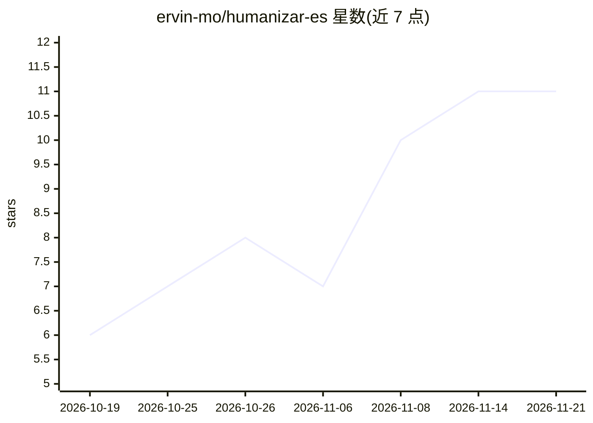

# ervin-mo/humanizar-es

⭐ 11 · Python · NOASSERTION · 推送 2026-11-12 · [GitHub](https://github.com/ervin-mo/humanizar-es) · 个人维护

**本地运行的西语/英语 AI 文本人性化改写工具**

四阶段流水线：用无对话训练的 base 模型（Qwen3-4B-Base + HIP adapter，经 llama.cpp 在 CPU 上运行）改写文本，保真检查保留概念与引文，重组句长节奏，对仍被检测器标记的段落多候选采样并按整篇测分择优。既可手工用 Python 脚本逐段操作，也可作为 Claude Code、Codex、OpenCode 等 agent 的 skill 安装。支持西班牙语与英语，其他语言需自行扩展连接词词典。

## 筛选速览

| 维度 | 判定 | 备注 |
|---|---|---|
| AI 角色 | `ai-native` | 本体是模型或模型工具 |
| 许可风险 | `permissive` | NOASSERTION |
| 部署形态 | `None` |  |
| 模型依赖 | — | README 未给出锁定关系 |
| 硬件要求 | — | 无带数字的原话,不猜 |
| 安装摩擦 | `low` | 无编译、无系统依赖或容器化 |
| 成熟度 | — | 结构信号不足 |

## 能力要点

- 基于 Qwen3-4B-Base + HIP adapter 的本地改写，无 API、无 key，文本不离开本机
- 保真检查：概念清单、引文逐字保留、否定与重音保护，超限段落由模型重新生成
- 节奏重组与多候选选择两阶段，针对 Grammarly/ZeroGPT/GPTZero 的不同信号
- 可作为 Claude Code/Codex/OpenCode/Antigravity/Gemini CLI 的 skill 安装

## 适用场景

- 把 ChatGPT/Claude 生成的西语或英语文稿本地改写
- 作为编码 agent 的 skill 在会话中直接 humanize 文本
- 写作时保留专名、术语与引文的同时降低检测器分数

## 场景标签

`AI 写作` · 领域:内容生成

## 证据(README 行号)

> L12: **humanizar-es** takes a text written with ChatGPT, Claude, Gemini or DeepSeek and gives
> L66: Qwen3-4B-Base plus the paper's HIP adapter, through llama.cpp, on your CPU.
> L188: It runs on CPU: 8 GB of free RAM is enough, no GPU. On an M4 Mac it takes about 30–60

## 星数曲线

2026-10-19 6 → 2026-11-21 11（+5）

---
*卡片 v1 · prompt 1.4 · 生成 2026-11-18 · 置信度 high · 依据 README sha `e0bccd1ded56` · [字段定义](../../DATASET.md)*
