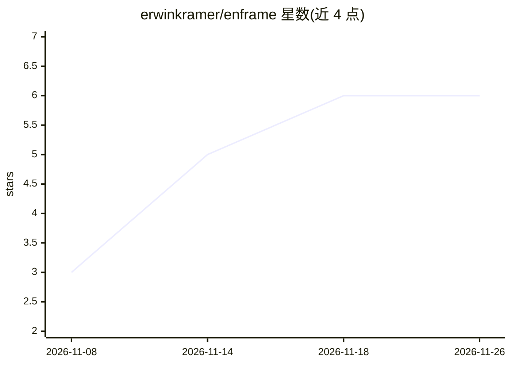

# erwinkramer/enframe

⭐ 6 · C# · NOASSERTION · 推送 2026-11-19 · [GitHub](https://github.com/erwinkramer/enframe) · [官网](https://guanchen.nl) · 个人维护

**把任意 OpenAPI 规范包装成 MCP 服务器的容器化 sidecar**

以容器形式运行的 sidecar：读取 Swagger 2.0 或 OpenAPI 3.0-3.2 规范，将每个 Operation 映射为一个 MCP 工具（含输入/输出 schema、工具注解），自动从规范推断 API key、OAuth 2.0、OpenID Connect 等认证。基于 C# MCP SDK 与 Native AOT 构建，镜像约 43 MB。用户只需提供规范 URL 或文件路径即可启动服务器，供任意符合 MCP 规范的客户端接入。

## 筛选速览

| 维度 | 判定 | 备注 |
|---|---|---|
| AI 角色 | `ai-ecosystem` | LLM/agent 周边工具 |
| 许可风险 | `none` | NOASSERTION |
| 部署形态 | `library` | 以包/库形式分发 |
| 模型依赖 | — | README 未给出锁定关系 |
| 硬件要求 | — | 无带数字的原话,不猜 |
| 安装摩擦 | `low` | 无编译、无系统依赖或容器化 |
| 成熟度 | — | 结构信号不足 |

## 能力要点

- 读取 Swagger 2.0/OpenAPI 3.0-3.2 规范并生成 MCP 工具 schema（JSON Schema 2020-12）
- 自动推断 API key、OAuth 2.0、OpenID Connect 认证
- 基于官方 C# SDK，支持 MCP 规范版本协商
- 约 43 MB 镜像，Native AOT 构建

## 适用场景

- 让 MCP 客户端直接调用已有 OpenAPI 描述的 REST API
- 为内部 API 快速生成可供 LLM 客户端访问的工具集
- 在云原生环境中以 sidecar 方式暴露服务工具

## 场景标签

 · 领域:开发者工具/API 集成

## 证据(README 行号)

> L3: # wrap any OpenAPI spec into an MCP server
> L12: If you have a well-specified API with OpenAPI, **Enframe rewards you**: it takes almost no configuration to get an 
> L37: - **MCP:** official C# SDK 2.x — implements spec revision `2026-07-28`, negotiates down to `2025-11-25` and earlier

## 星数曲线

2026-11-08 3 → 2026-11-26 6（+3）

---
*卡片 v1 · prompt 1.4 · 生成 2026-11-20 · 置信度 mid · 依据 README sha `643673ba6405` · [字段定义](../../DATASET.md)*
