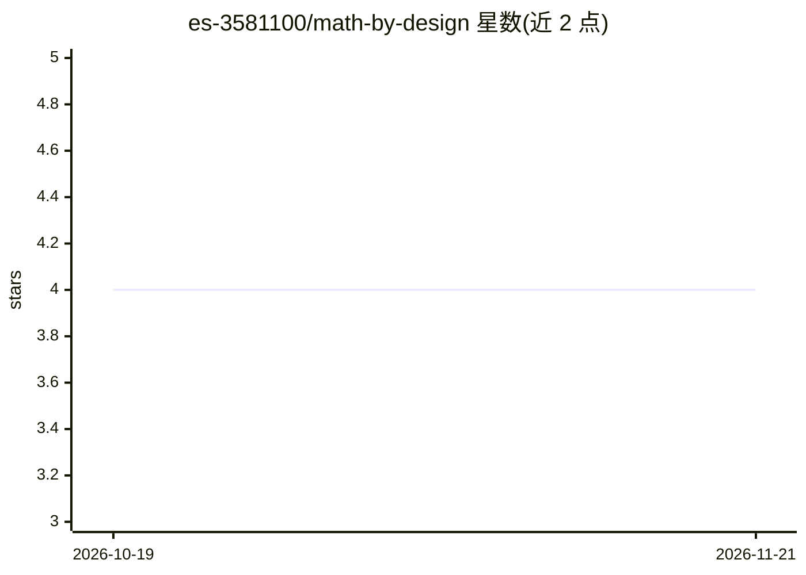

# es-3581100/math-by-design

⭐ 4 · HTML · Apache-2.0 · 推送 2026-10-10 · [GitHub](https://github.com/es-3581100/math-by-design) · [官网](https://es-3581100.github.io/math-by-design/) · 个人维护

**给 AI agent 用的数学化 UI 设计语法与调色/字体引擎**

面向 coding agent 的设计语法资料集：由多份 HTML 参考（Phi Flow 层级契约、材质语言、反模板规则、多 agent 协议与 F1–F5 校验门）加两个 Python 引擎组成。调色引擎基于 SymPy/NumPy 按斐波那契等比率族生成可复现色板，报告可用节点并在相邻 ΔE 低于阈值时停止；排版引擎从项目论点推导角色基因组，在显式关系模式下生成并校验字体系统。依赖 Python 的 numpy 与 sympy，scipy 可选。

## 筛选速览

| 维度 | 判定 | 备注 |
|---|---|---|
| AI 角色 | `ai-knowledge` | 知识聚合/清单类 |
| 许可风险 | `permissive` | Apache-2.0 |
| 部署形态 | `None` |  |
| 模型依赖 | — | README 未给出锁定关系 |
| 硬件要求 | — | 无带数字的原话,不猜 |
| 安装摩擦 | `low` | 无编译、无系统依赖或容器化 |
| 成熟度 | — | 结构信号不足 |

## 能力要点

- 可复现的 SymPy/NumPy 调色引擎，输出含种子、对比度证据与 adjustments 轨迹
- 因果式排版引擎：job graph → genome → 候选系统 → 关系评分 → 实现校验
- 多份 agent 参考：Phi Flow 布局契约、多 agent 协议、F1–F5 校验门
- 要求 SHA-256 与精确来源名保留设计谱系

## 适用场景

- 让 coding agent 按 Phi Flow 契约生成落地页布局
- 为项目生成有数学来源的可复现配色
- 在显式关系模式下推导并校验字体系统
- 校验生成界面的层级漂移与可访问性前置条件

## 场景标签

`编码 Agent` · 领域:编码与开发

## 证据(README 行号)

> L5: A small agent-facing design grammar for building interfaces from **hierarchy, material, mathematical color relations
> L7: The project is intentionally split into human/dev references and callable palette + typography engines:

## 星数曲线

2026-10-19 4 → 2026-11-21 4（+0）

---
*卡片 v1 · prompt 1.4 · 生成 2026-11-21 · 置信度 high · 依据 README sha `b6af530fcf44` · [字段定义](../../DATASET.md)*
