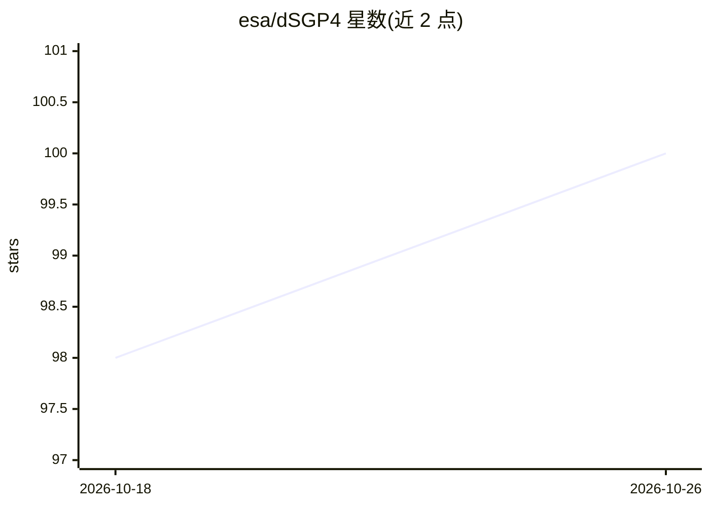

# esa/dSGP4

⭐ 100 · Python · GPL-3.0 · 推送 2026-10-16 · [GitHub](https://github.com/esa/dSGP4) · [官网](https://esa.github.io/dSGP4/) · 组织维护

**可微 SGP4 轨道传播库：PyTorch 自动微分+ML 集成**

ESA 维护的 PyTorch 版 SGP4 轨道传播实现，支持对传播状态关于时间与 TLE 参数求梯度，用于状态转移矩阵估计、协方差传播、梯度法轨道估计等。提供 TLE 与 CCSDS OMM（JSON/XML/KVN/CSV）的解析/写入/转换、单对象与批处理传播 API，以及学习 SGP4 动力学修正的混合模型 mldsgp4。另附实验性 MCP server，可将六个工具域暴露给 Claude 类 LLM 客户端。限制：tsince 以分钟计、目录号超过 339999 的对象无法转为 TLE。

## 筛选速览

| 维度 | 判定 | 备注 |
|---|---|---|
| AI 角色 | `ai-native` | 本体是模型或模型工具 |
| 许可风险 | `viral` | GPL-3.0 |
| 部署形态 | `library` | 以包/库形式分发 |
| 模型依赖 | — | README 未给出锁定关系 |
| 硬件要求 | — | 无带数字的原话,不猜 |
| 安装摩擦 | `low` | 无编译、无系统依赖或容器化 |
| 成熟度 | `idea` | |

## 能力要点

- SGP4 的 PyTorch 实现与 autograd 梯度支持
- TLE 与 CCSDS OMM 四种序列化格式的解析与互转
- 单对象与批处理传播 API
- 可选 MCP server 向 LLM 客户端暴露 TLE/传播/梯度/估计/ML 工具域

## 适用场景

- 对传播状态做梯度式轨道估计与协方差传播
- 用 ML 修正模型提升 SGP4 预报精度
- 通过 MCP 让 LLM agent 调用轨道解析与传播工具

## 场景标签

 · 领域:航天动力学/科学计算

## 证据(README 行号)

> L9: Differentiable SGP4 in PyTorch.
> L21: - A PyTorch implementation of SGP4 with autograd support.
> L25: - A hybrid model (`mldsgp4`) for learning corrections around SGP4 dynamics.

## 星数曲线

2026-10-18 98 → 2026-10-26 100（+2）

---
*卡片 v1 · prompt 1.4 · 生成 2026-10-23 · 置信度 mid · 依据 README sha `22e34fdcd4fc` · [字段定义](../../DATASET.md)*
