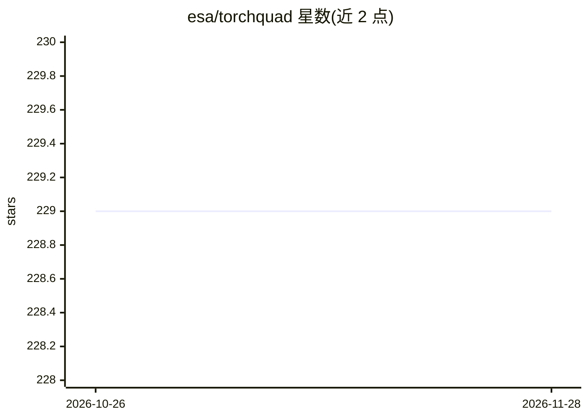

# esa/torchquad

⭐ 229 · Python · GPL-3.0 · 推送 2026-11-12 · [GitHub](https://github.com/esa/torchquad) · [官网](https://www.esa.int/gsp/ACT/open_source/torchquad/) · 组织维护

**面向科研与 ML 社区的 GPU 高维数值积分库**

torchquad 提供 GPU 上的任意维数值积分，基于 autoray 构建，支持 PyTorch、JAX、TensorFlow 与 NumPy 后端，在选用 ML 后端时可完全微分。集成多种求积方法（梯形、Simpson、Boole、Gauss-Legendre、Monte Carlo、Sobol 准蒙特卡洛、VEGAS 等），面向物理、金融、医学统计等需高维积分的研究群体与机器学习社区。通过 pip/uv/conda 安装，无固定硬依赖后端，也可在 CPU 上运行但以 GPU 为优化目标。

## 筛选速览

| 维度 | 判定 | 备注 |
|---|---|---|
| AI 角色 | `ai-enhanced` | 去掉 AI 部分产品仍成立 |
| 许可风险 | `viral` | GPL-3.0 |
| 部署形态 | `library` | 以包/库形式分发 |
| 模型依赖 | — | README 未给出锁定关系 |
| 硬件要求 | `cpu-ok` | |
| 安装摩擦 | `medium` | 含编译或系统依赖之一 |
| 成熟度 | — | 结构信号不足 |

## 能力要点

- 基于 autoray 支持 NumPy/PyTorch/JAX/TensorFlow 多后端，单 API 覆盖
- 后端可用时完全可微分
- 内置 Monte Carlo、准蒙特卡洛（Sobol）、VEGAS 与高阶 Newton-Cotes 等方法
- 多 GPU 使用支持（CUDA_VISIBLE_DEVICES 与多进程并行）

## 适用场景

- 物理、金融、医学统计中的高维数值积分计算
- 需要与可微分计算图结合的积分计算
- 大规模积分问题利用 GPU 并行加速
- 同一 API 下切换不同数值后端做基准对比

## 场景标签

 · 领域:科学计算/数值方法

## 证据(README 行号)

> L46: The torchquad module allows utilizing GPUs for efficient numerical integration with PyTorch and other numerical Pyt
> L53: * autoray, which means the implemented quadrature supports NumPy and can be used for machine learning with modules 
> L60: * **Supporting science**: Multidimensional numerical integration is needed in many fields, such as physics (from pa

## 星数曲线

2026-10-26 229 → 2026-11-28 229（+0）

---
*卡片 v1 · prompt 1.4 · 生成 2026-11-25 · 置信度 mid · 依据 README sha `12e63f00359e` · [字段定义](../../DATASET.md)*
