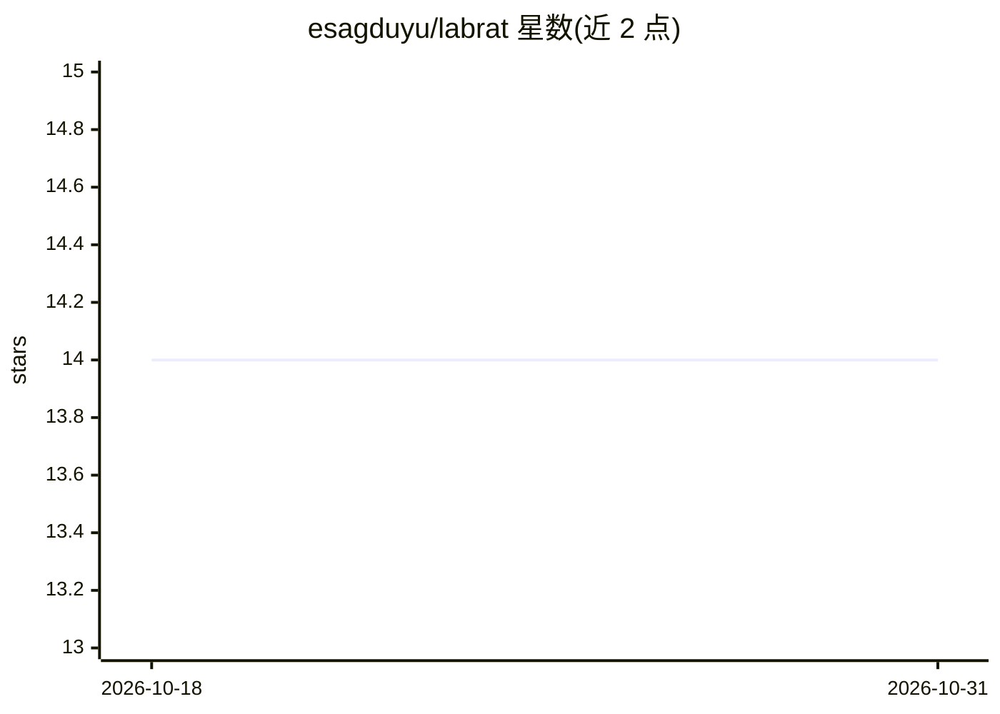

# esagduyu/labrat

⭐ 14 · Python · 推送 2026-08-06 · [GitHub](https://github.com/esagduyu/labrat) · 个人维护

**终端原生 AI 数据 agent：用自然语言查询数据仓库并生成 SQL 答案**

面向数据科学家与分析工程师的终端 TUI 应用：连接数据仓库（DuckDB/Postgres/Snowflake/BigQuery/Redshift/Trino/MySQL 共 7 种适配器），用自然语言提问后，agent 探索 schema、实时流式生成方言正确的 SQL，经安全门（只读、AST 检查、成本门控）执行并给出带溯源的回答。支持 4 种 LLM 提供方（Anthropic API、Claude Code CLI、OpenAI 兼容、GPT‑5.5/5.6 订阅路径），核心可经 MCP server 嵌入 Claude Code/Cursor 等宿主。自述为 feature-complete v0 alpha，安装方式目前为源码构建（Python 3.12+，uv）。

## 筛选速览

| 维度 | 判定 | 备注 |
|---|---|---|
| AI 角色 | `ai-native` | 本体是模型或模型工具 |
| 许可风险 | `none` | — |
| 部署形态 | `None` |  |
| 模型依赖 | locked-api |  |
| 硬件要求 | — | 无带数字的原话,不猜 |
| 安装摩擦 | `low` | 无编译、无系统依赖或容器化 |
| 成熟度 | `idea` | |

## 能力要点

- 7 种仓库适配器与 22 个 agent 工具（含 profile_dataset/verify_join 接地与安全门）
- 3 栏 TUI：对话 + 流式 SQL 编辑器 + schema 浏览器
- MCP server 可将工具注册表挂载进 Claude Code/Codex/Cursor 等宿主
- 事件溯源审计日志与带溯源的 HTML 报告导出；查询历史与自愈记忆

## 适用场景

- 在终端用自然语言查询自有数据仓库并获得可核查的 SQL 答案
- 把工具层经 MCP 嵌入已有编码 agent 中执行数据分析
- 结合 dbt catalog 做分析工程任务的 agent 化执行

## 场景标签

`数据分析` · 领域:效率与自动化

## 证据(README 行号)

> L5: **LabRat is a terminal-native AI data agent — and the start of "Claude Code for data scientists."** Connect to your 
> L76: |4 LLM providers|✅|Anthropic API · Claude Code CLI (Mac OAuth, Max plan) · OpenAI-compatible · GPT‑5.5/5.6 via Chat
> L127: > show me Q4 revenue by region

## 星数曲线

2026-10-18 14 → 2026-10-31 14（+0）

---
*卡片 v1 · prompt 1.4 · 生成 2026-10-31 · 置信度 high · 依据 README sha `5de3c76bccaa` · [字段定义](../../DATASET.md)*
