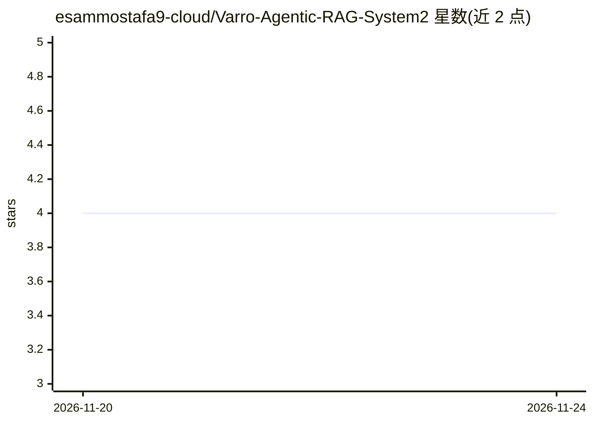

# esammostafa9-cloud/Varro-Agentic-RAG-System2

⭐ 4 · Python · MIT · 推送 2026-11-19 · [GitHub](https://github.com/esammostafa9-cloud/Varro-Agentic-RAG-System2) · [官网](https://esammostafa9-cloud.github.io/Varro-Agentic-RAG-System2/) · 个人维护

**本地优先的个人文档 RAG 助手：带引用与提示注入防护**

运行在本机的私有文档问答应用：FastAPI 后端配合嵌入式 Chroma 与 BM25+BGE 混合检索、cross-encoder 重排，每条事实句附带编号引用并高亮 PDF 原文；文档中的任务动作转为待人工审批的草稿任务，Agent 起草内容须经批准才生效。内置提示注入检测（伪装字符/base64）与角色权限的团队模式。检索与存储全部本地运行，仅问题与少量片段发往 Groq 上的 GPT-OSS 模型。提供 Docker 与 Python 两种启动方式及演示工作区。

## 筛选速览

| 维度 | 判定 | 备注 |
|---|---|---|
| AI 角色 | `ai-native` | 本体是模型或模型工具 |
| 许可风险 | `permissive` | MIT |
| 部署形态 | `self-host` | docker 或自建部署 |
| 模型依赖 | locked-api |  |
| 硬件要求 | — | 无带数字的原话,不猜 |
| 安装摩擦 | `low` | 无编译、无系统依赖或容器化 |
| 成熟度 | — | 结构信号不足 |

## 能力要点

- 每条事实句引用编号段落，点击打开 PDF 并高亮原文
- 混合检索：BM25+BGE 融合，cross-encoder 重排
- 提示注入检测：识别伪装字符、隐形字符与 base64 指令
- 团队模式支持账户与角色（viewer/member/manager/admin）

## 适用场景

- 在本地对报告、合同等私人文档提问并核验出处
- 从文档中抽取截止日期与任务并经审批进入看板
- 多人共享一个本地工作区并按角色分配权限

## 场景标签

`文档问答` `RAG` · 领域:知识与检索

## 证据(README 行号)

> L10: Varro is a private research assistant for your own documents that runs on your own computer. Ask a question in plai
> L35: - **Private by design.** Documents, embeddings, search and storage stay on your machine; only the question and the 
> L43: A question is planned into standalone queries, searched by keywords and embeddings together, reranked, screened for

## 星数曲线

2026-11-20 4 → 2026-11-24 4（+0）

---
*卡片 v1 · prompt 1.4 · 生成 2026-11-21 · 置信度 high · 依据 README sha `29e49c43311d` · [字段定义](../../DATASET.md)*
