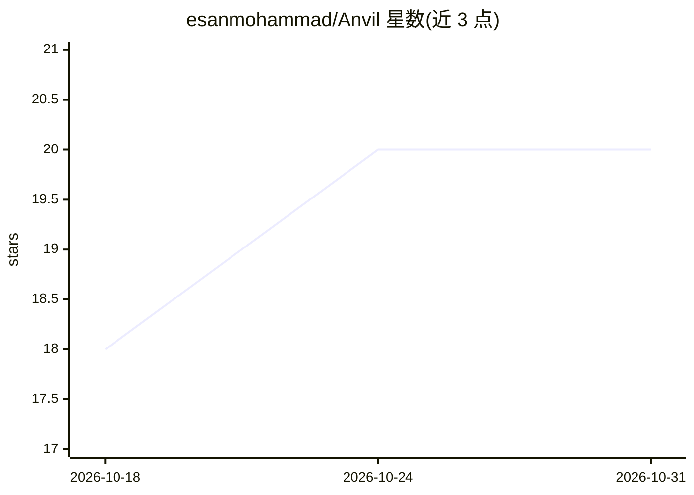

# esanmohammad/Anvil

⭐ 20 · TypeScript · MIT · 推送 2026-10-24 · [GitHub](https://github.com/esanmohammad/Anvil) · [官网](https://drive.google.com/file/d/1IHTQiLEQ4tulpdbUzI2iD5dmy82jBK-m/view?usp=sharing) · 个人维护

**自托管的开源 AI 编码 agent：按阶段混用多家模型交付功能流水线**

用 TypeScript 编写、npm 全局安装的命令行 AI 编码 agent，围绕 clarify → plan → build → test → validate → ship 的多阶段流水线在多仓库项目上交付代码与 PR。支持 8 个模型供应方（Claude/OpenAI/Gemini/OpenRouter/Ollama/OpenCode 等），路由按阶段配置在 YAML 中，使用用户自有 API key，适配器为手写 fetch 而非各厂商 SDK。内置提供方故障自动降级、单 GPU 独占槽排队、实时成本账本、OpenTelemetry 观测（默认关闭）、SQLite 持久化执行、阶段级策略门禁与回滚，知识库检索引擎另以 MCP server 形式暴露。

## 筛选速览

| 维度 | 判定 | 备注 |
|---|---|---|
| AI 角色 | `ai-ecosystem` | LLM/agent 周边工具 |
| 许可风险 | `permissive` | MIT |
| 部署形态 | `self-host` | docker 或自建部署 |
| 模型依赖 | local-ok | 支持本地模型 |
| 硬件要求 | — | 无带数字的原话,不猜 |
| 安装摩擦 | `low` | 无编译、无系统依赖或容器化 |
| 成熟度 | `idea` | |

## 能力要点

- 按阶段混用 8 个供应方的模型路由（models.yaml / stage-policy.yaml）
- 提供方 429/5xx/探活失败时链式自动降级，不重试同一故障模型
- 单 GPU 多大模型的独占槽 FIFO 排队与显存逐出
- SQLite 事件日志持久化执行，可断点续跑与一键回滚

## 适用场景

- 在多仓库项目里跑从规划到 PR 的自动化编码流水线
- 按阶段把任务路由到便宜或本地模型以控制 token 成本
- 把项目知识库作为 MCP server 接入 Claude Code/Cursor 等客户端

## 场景标签

`编码 Agent` `RAG` · 领域:编码与开发

## 证据(README 行号)

> L11:  Anvil is an open-source, self-hosted AI coding agent — an end-to-end LLM pipeline
> L13:  local via Ollama &amp; OpenCode. It speaks the Model Context Protocol (MCP) and uses your own
> L80: Eight providers ship in the box. One config file picks them per

## 星数曲线

2026-10-18 18 → 2026-10-31 20（+2）

---
*卡片 v1 · prompt 1.4 · 生成 2026-10-28 · 置信度 low · 依据 README sha `e724d71781d3` · [字段定义](../../DATASET.md)*
