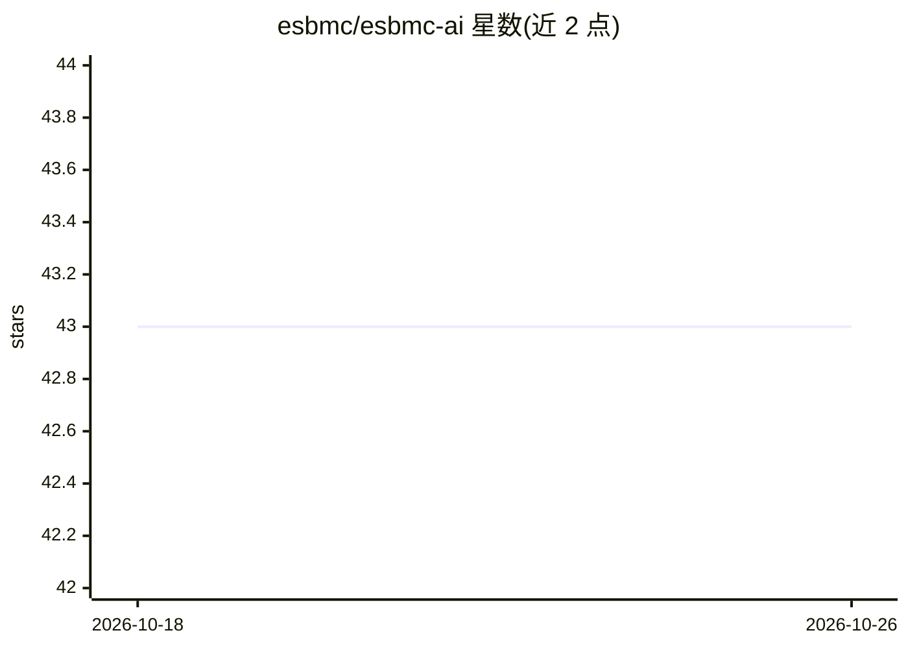

# esbmc/esbmc-ai

⭐ 43 · Python · NOASSERTION · 推送 2026-02-20 · [GitHub](https://github.com/esbmc/esbmc-ai) · [官网](https://esbmc.github.io/esbmc-ai/) · 组织维护

**面向自动程序修复研究的 LLM 集成工作流平台**

ESBMC-AI 是围绕有界模型检测器 ESBMC 构建的 LLM 集成工作流平台，主要面向自动程序修复（APR）研究。基本修复实现将 ESBMC 的技术性输出连同修复指令交给 AI 模型生成修复代码；平台提供多个可执行命令，并支持通过 Addons 扩展功能。以 Python（hatch）运行，文档与详细配置托管在 Wiki，另有 Quay 上的 Docker 仓库与 YouTube 演示视频。

## 筛选速览

| 维度 | 判定 | 备注 |
|---|---|---|
| AI 角色 | `ai-native` | 本体是模型或模型工具 |
| 许可风险 | `none` | NOASSERTION |
| 部署形态 | `None` |  |
| 模型依赖 | — | README 未给出锁定关系 |
| 硬件要求 | — | 无带数字的原话,不猜 |
| 安装摩擦 | `low` | 无编译、无系统依赖或容器化 |
| 成熟度 | — | 结构信号不足 |

## 能力要点

- 将 ESBMC 检测输出传递给 AI 模型生成代码修复
- 内置多个命令并支持 Addons 扩展
- 提供 Docker 镜像（Quay）与演示视频

## 适用场景

- 研究人员借助形式化验证反馈做自动程序修复实验
- 基于 ESBMC 反例定位并生成补丁
- 通过 Addon 扩展修复与验证工作流

## 场景标签

`编码 Agent` · 领域:编码与开发

## 证据(README 行号)

> L7: Automated LLM Integrated Workflow Platform. Primarily oriented around Automated Program Repair (APR) research. There
> L9: The basic repair implementation passes the output from ESBMC to an AI model with instructions to repair the code. As

## 星数曲线

2026-10-18 43 → 2026-10-26 43（+0）

---
*卡片 v1 · prompt 1.4 · 生成 2026-10-25 · 置信度 mid · 依据 README sha `8be1fa6f553b` · [字段定义](../../DATASET.md)*
