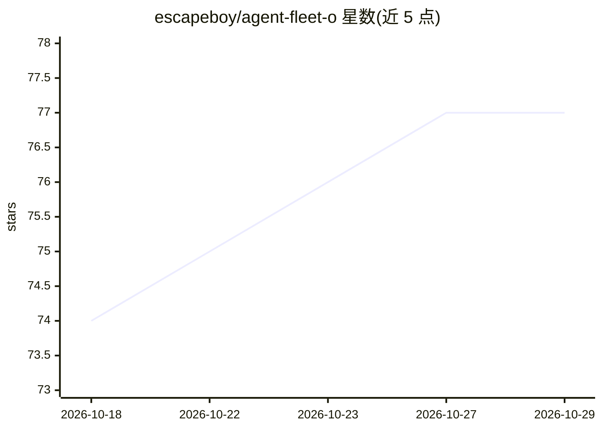

# escapeboy/agent-fleet-o

⭐ 77 · PHP · AGPL-3.0 · 推送 2026-10-26 · [GitHub](https://github.com/escapeboy/agent-fleet-o) · [官网](https://fleetq.net) · 个人维护

**自托管多 AI agent 编排平台：可视化 DAG 工作流与治理**

基于 Laravel/Livewire 的开源（AGPLv3）AI agent 编排平台，供需要自托管运行与监控自主多 agent 系统的团队使用。提供可视化 DAG 工作流构建器（8 种节点类型）、多 agent Crew 协作、670+ MCP 工具、human-in-the-loop 审批、预算/信用账本与审计日志。模型接入采用 BYOK，支持 Anthropic/OpenAI/Google 及 Ollama、LM Studio、vLLM 等本地运行时，可经 Docker Compose 部署，另有托管版 FleetQ Cloud。本体为编排/运行平台而非直接产出内容的终端应用。

## 筛选速览

| 维度 | 判定 | 备注 |
|---|---|---|
| AI 角色 | `ai-ecosystem` | LLM/agent 周边工具 |
| 许可风险 | `viral` | AGPL-3.0 |
| 部署形态 | `self-host` | docker 或自建部署 |
| 模型依赖 | local-ok | 支持本地模型 |
| 硬件要求 | — | 无带数字的原话,不猜 |
| 安装摩擦 | `low` | 无编译、无系统依赖或容器化 |
| 成熟度 | — | 结构信号不足 |

## 能力要点

- 可视化 DAG 工作流构建器，8 种节点类型，无需 Python 胶水代码
- 670+ MCP 工具（60+ 域），stdio/HTTP SSE/OAuth2 通道
- 多 agent Crew（coordinator/worker/reviewer 角色、加权 QA 评分）与 human-in-the-loop 审批
- BYOK + 本地 LLM：Ollama、LM Studio、vLLM、llama.cpp 经 OpenAI 兼容端点接入

## 适用场景

- 搭建并监控自主多 agent 系统的生产平台
- 通过可视化 DAG 编排含人工审批节点的循环工作流
- 将平台能力通过 MCP 暴露给 Claude Desktop、Cursor 等外部 agent 调用

## 场景标签

`Agent 框架` `多智能体` `工作流自动化` · 领域:Agent 开发

## 证据(README 行号)

> L3: > **Self-hosted mission control for AI agents.** Build, run, and monitor autonomous multi-agent systems with a visua
> L20: Most agent frameworks give you a Python notebook. FleetQ gives you a **production platform**.
> L28: - ⚙️ **BYOK + Local LLMs** — Anthropic, OpenAI, Google, plus Ollama, LM Studio, vLLM, Codex, Claude Code. Zero vend

## 星数曲线

2026-10-18 74 → 2026-10-29 77（+3）

---
*卡片 v1 · prompt 1.4 · 生成 2026-10-24 · 置信度 high · 依据 README sha `fa63f562c148` · [字段定义](../../DATASET.md)*
