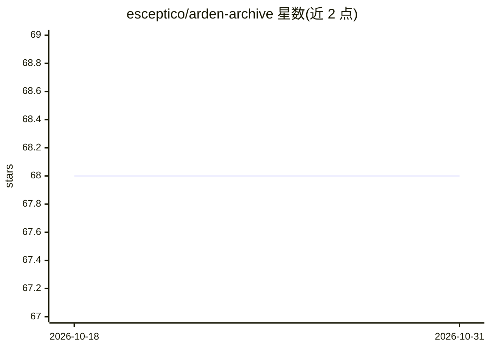

# esceptico/arden-archive

⭐ 68 · Python · MIT · 推送 2026-08-09 · [GitHub](https://github.com/esceptico/arden-archive) · 个人维护

**本地优先的个人 AI 助理：统一管理对话、记忆与工具**

Arden 是连接对话、记忆、工具与日常事务的个人 AI agent，以本地优先的持久工作区形式运行，声明不是编码 agent，而是提醒用户'什么需要关注'的个人助理。架构为 Python 后端（FastAPI，含 agent 运行时、记忆、集成）加 Electron 桌面客户端，从源码 checkout 安装，或以 Docker 做 server-only 部署；需配置一个 provider API key。本仓库为保存的 MIT 许可公开版本归档（artifact）。

## 筛选速览

| 维度 | 判定 | 备注 |
|---|---|---|
| AI 角色 | `ai-native` | 本体是模型或模型工具 |
| 许可风险 | `permissive` | MIT |
| 部署形态 | `self-host` | docker 或自建部署 |
| 模型依赖 | — | README 未给出锁定关系 |
| 硬件要求 | — | 无带数字的原话,不猜 |
| 安装摩擦 | `low` | 无编译、无系统依赖或容器化 |
| 成熟度 | — | 结构信号不足 |

## 能力要点

- 对话、记忆、工具、日常事务整合在同一持久工作区
- FastAPI 后端含 agent 运行时/记忆/集成模块 + Electron 桌面客户端
- 支持源码运行与 Docker server-only 部署两种方式

## 适用场景

- 把个人事务的对话与记忆集中在一个本地系统里管理
- 让 AI 助理提醒自己哪些事情需要处理

## 场景标签

`AI 助手` · 领域:对话与助手

## 证据(README 行号)

> L5: **Arden** is a personal AI agent that connects your conversations, memory, tools, and recurring work in one durable 
> L7: A local-first personal assistant. Not a coding agent: a place to keep the moving parts of your life in one system th

## 星数曲线

2026-10-18 68 → 2026-10-31 68（+0）

---
*卡片 v1 · prompt 1.4 · 生成 2026-10-24 · 置信度 mid · 依据 README sha `0e8ef686872c` · [字段定义](../../DATASET.md)*
