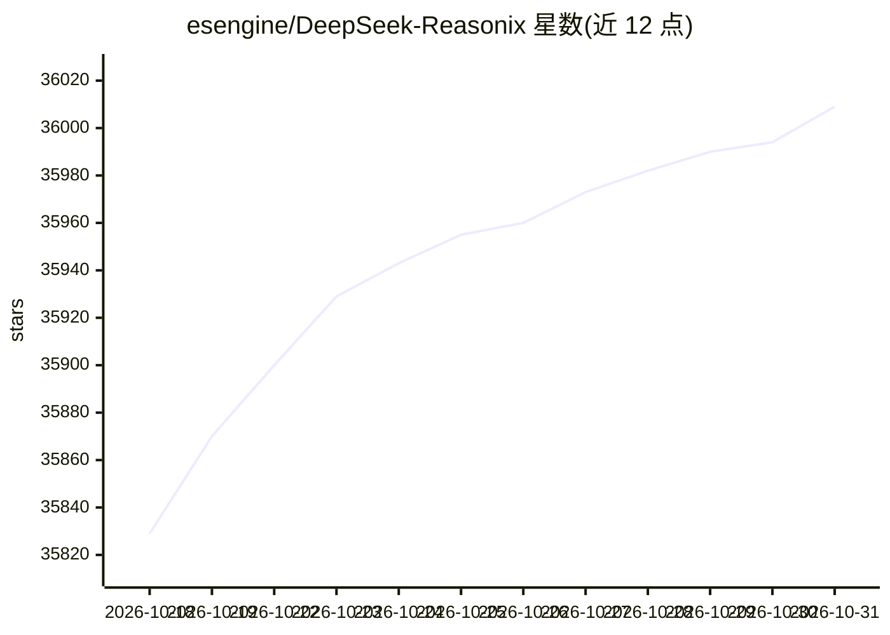

# esengine/DeepSeek-Reasonix

⭐ 36,009 · Go · MIT · 推送 2026-10-30 · [GitHub](https://github.com/esengine/DeepSeek-Reasonix) · [官网](http://reasonix.io/) · 个人维护 · 中文 README

**开源终端/桌面/编辑器 AI 编码代理，模型自选**

Reasonix 是开源 AI 编码代理，以桌面应用（Studio）、终端 TUI/CLI、本地 Web 界面和 VS Code/ACP 编辑器扩展四种形态运行同一本地引擎。它读取项目代码、编辑文件、运行命令与测试，支持逐次授权或限定范围内自主工作，被编辑工具改动的文件可按对话轮回退。模型需自行配置：内置 DeepSeek 预设，任何 OpenAI 兼容服务写入配置即可。配置驱动（reasonix.toml），支持 MCP 插件、双模型（执行+规划）组合，发布 CGO_ENABLED=0 单二进制。存在 2.x（活跃开发）与 1.x（维护/稳定）两条版本线。

## 筛选速览

| 维度 | 判定 | 备注 |
|---|---|---|
| AI 角色 | `ai-native` | 本体是模型或模型工具 |
| 许可风险 | `permissive` | MIT |
| 部署形态 | `desktop` | 安装包/桌面程序 |
| 模型依赖 | locked-api |  |
| 硬件要求 | — | 无带数字的原话,不猜 |
| 安装摩擦 | `low` | 无编译、无系统依赖或容器化 |
| 成熟度 | `idea` | |

## 动量与使用信号

- 维护:`active` — 距上次 push 0.6 天,年发版 100,158 位贡献者
- 涨星:近 1 天 **+12**(自 20261016 起算)
- 安装:npm 包 `reasonix` 月下载 18,541
- 平台:— · 协议:OPENAI-API / MCP

## 能力要点

- 桌面/终端/浏览器/编辑器四种形态共用同一本地引擎
- 权限分级与计划模式，编辑过的文件可按对话轮回退
- 内置 DeepSeek 预设，任意 OpenAI 兼容端点一条配置接入
- MCP 插件、Extension Protocol v1 边车与双模型（executor+planner）组合
- CGO_ENABLED=0 静态单二进制，一条命令交叉编译六个目标

## 适用场景

- 在终端或桌面用自然语言驱动代码修改、运行测试
- 在 VS Code 或支持 ACP 的编辑器内作为 AI 编码助手连接
- 通过 DeepSeek Harness 以 ACP 子代理方式派发任务
- 自选模型服务商的本地编码代理工作流

## 场景标签

`编码 Agent` · 领域:编码与开发

## 证据(README 行号)

> L37:  An open-source coding agent for your terminal, desktop, browser and editor.
> L54: Reasonix is an open-source AI coding assistant. The program runs on your computer; the AI model is a service you co
> L56: You pick the model: a DeepSeek preset is built in, any OpenAI-compatible service is one config entry, and you pay t

## 星数曲线

2026-10-18 35,829 → 2026-10-31 36,009（+180）

---
*卡片 v1 · prompt 1.4 · 生成 2026-10-20 · 置信度 high · 依据 README sha `6f60d59e011c` · [字段定义](../../DATASET.md)*
