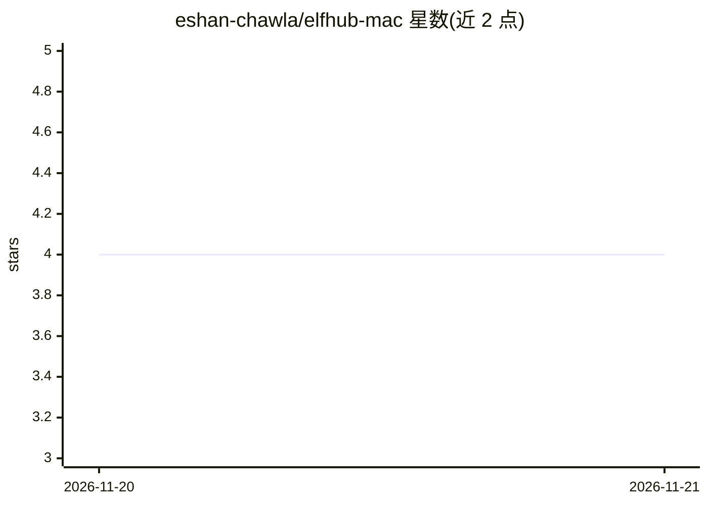

# eshan-chawla/elfhub-mac

⭐ 4 · Swift · AGPL-3.0 · 推送 2026-11-19 · [GitHub](https://github.com/eshan-chawla/elfhub-mac) · [官网](https://elfhub.ai/os) · 个人维护

**macOS 桌面 AI agent：看屏对话、标注指示、逐步代操作**

原生 SwiftUI 菜单栏/桌面应用，用户按住快捷键提问，agent 读取屏幕截图后语音回答、在界面元素上画箭头标注、把步骤写入浮窗记事本，并可在授权下逐步点击、输入、打开应用完成 computer-use 任务。采用 BYOK 模式：无官方服务器与账号，模型可选 ChatGPT 套餐、各家 API key 或本机 Ollama/LM Studio/llama.cpp。提供语音输入、屏幕绘制、权限护栏、本地动作日志与 .elf 分享。公共 beta，AGPL-3.0，需 macOS 14.2+ Apple silicon。

## 筛选速览

| 维度 | 判定 | 备注 |
|---|---|---|
| AI 角色 | `ai-native` | 本体是模型或模型工具 |
| 许可风险 | `viral` | AGPL-3.0 |
| 部署形态 | `desktop` | 安装包/桌面程序 |
| 模型依赖 | local-ok | 支持本地模型 |
| 硬件要求 | — | 无带数字的原话,不猜 |
| 安装摩擦 | `medium` | 含编译或系统依赖之一 |
| 成熟度 | `idea` | |

## 能力要点

- 语音提问→屏幕截图→语音回答+屏幕标注+步骤记事本的完整回合管线
- action mode 逐步 computer use，含权限分级（ask first/auto/allow all）与本地动作日志
- BYOK：支持 ChatGPT 套餐、多家云 API 及 Ollama/LM Studio/llama.cpp 本地模型
- 多 Elf 团队：独立记忆、技能（SKILL.md 格式）、后台任务与文件夹工作区

## 适用场景

- 让 AI 指认屏幕上的按钮并一步步完成设置操作
- 不切换窗口、快捷键即问即答当前屏幕内容
- 用本机 Ollama 模型在本地运行桌面助手
- 给不同任务配置不同人格与技能的多个 agent

## 场景标签

`GUI 自动化` `AI 助手` · 领域:效率与自动化

## 证据(README 行号)

> L5:  AI agents that live on your Mac — they see your screen, talk with you, point at what matters, and act when you ask.
> L13: elfhub is **desktop-first and bring-your-own-key**. There is no elfhub server, account or analytics: you pick the m
> L57: |**Language model**|**Continue with ChatGPT** (uses your ChatGPT plan, no key — with a fallback model for when the 

## 星数曲线

2026-11-20 4 → 2026-11-21 4（+0）

---
*卡片 v1 · prompt 1.4 · 生成 2026-11-21 · 置信度 high · 依据 README sha `c32b551a63df` · [字段定义](../../DATASET.md)*
