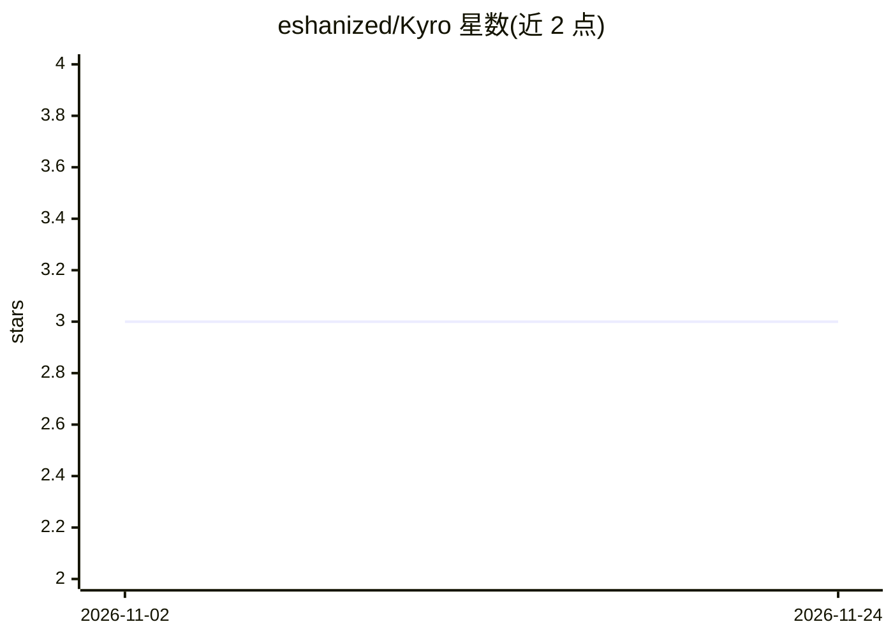

# eshanized/Kyro

⭐ 3 · Rust · MIT · 推送 2026-11-18 · [GitHub](https://github.com/eshanized/Kyro) · [官网](https://kyro.tonmoyinfrastructure.org/) · 个人维护

**本地优先的自主桌面 AI Agent，用自然语言操控电脑**

基于 Tauri v2、Rust 与 React 19 构建的桌面应用，将自然语言推理连接到真实计算机操作：屏幕理解、浏览器自动化（Firefox/Chromium 系）、终端执行与 MCP 集成。安全机制包括：shell 命令词法解析与注入防火墙、Docker 容器沙箱隔离、人类审批令牌绑定 run_id 与参数哈希、API 密钥存于 OS Keyring。提供日常模式（文件整理、文档助手、屏幕讲解）与开发者工作台（Build Doctor、UI 审计、多 Agent Git worktree 协作）。安装支持 curl 脚本与 Linux 预编译包。

## 筛选速览

| 维度 | 判定 | 备注 |
|---|---|---|
| AI 角色 | `ai-native` | 本体是模型或模型工具 |
| 许可风险 | `permissive` | MIT |
| 部署形态 | `desktop` | 安装包/桌面程序 |
| 模型依赖 | — | README 未给出锁定关系 |
| 硬件要求 | — | 无带数字的原话,不猜 |
| 安装摩擦 | `low` | 无编译、无系统依赖或容器化 |
| 成熟度 | — | 结构信号不足 |

## 能力要点

- Set-of-Marks 视觉定位与鼠标键盘底层模拟实现 computer-use
- MCP 完整客户端（stdio/HTTP JSON-RPC 2.0/SSE）与 GitHub/Google 连接器
- 零信任架构：shell 词法防火墙、容器沙箱、OS Keyring 加密存储
- 多 Agent（Apex/Forge/Scout）在隔离 Git worktree 中并行工作

## 适用场景

- 让 AI 代为执行桌面文件整理与文档解析
- 通过自然语言驱动浏览器自动化操作
- 开发者用 Build Doctor 自动诊断构建失败
- 用 Telegram 远程触发本机任务并接收通知

## 场景标签

`多智能体` `浏览器自动化` `GUI 自动化` · 领域:Agent 开发

## 证据(README 行号)

> L23: **Kyro** is a high-performance, local-first autonomous desktop AI agent that bridges natural language reasoning wit
> L95: - **Everyday Mode**: Intuitive natural language workflows for non-developers:
> L99: - **Dev Workbench**: Specialized tools for software engineers:

## 星数曲线

2026-11-02 3 → 2026-11-24 3（+0）

---
*卡片 v1 · prompt 1.4 · 生成 2026-11-22 · 置信度 mid · 依据 README sha `0fb23c289b51` · [字段定义](../../DATASET.md)*
