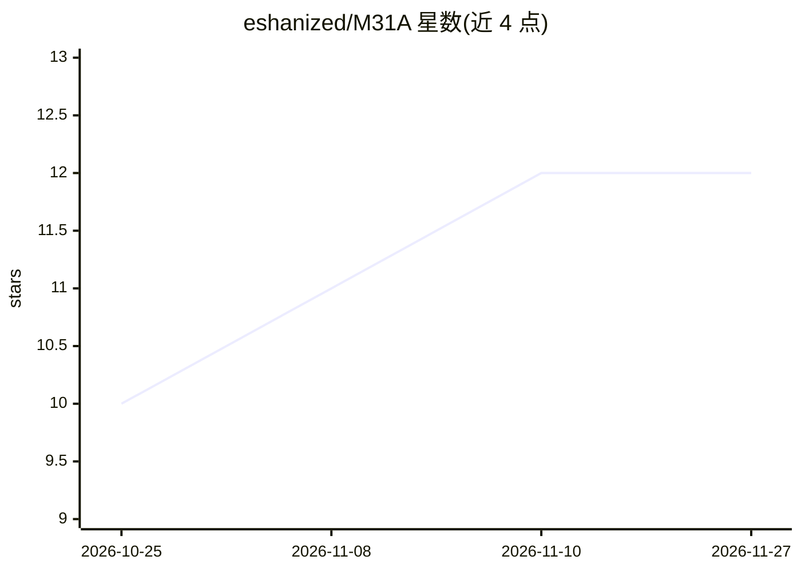

# eshanized/M31A

⭐ 12 · Rust · MIT · 推送 2026-11-22 · [GitHub](https://github.com/eshanized/M31A) · [官网](https://m31a.tonmoyinfrastructure.org/) · 个人维护

**Rust 编写的自主编程 Agent 运行时，面向开发者自动生成与修复代码**

以 Rust 2024（1.85+）实现的 39-crate 单仓库自主编程助手：通过 NVIDIA NIM 接入 Nemotron、DeepSeek、Codestral、Llama 等模型，在 Linux Bubblewrap 沙箱内执行命令，配合 AST 影响域门控、4 级模糊多文件补丁引擎与无头 Chromium 视觉 TDD 验证。提供 Ratatui 全屏终端 UI、54 个子命令的 CLI、JSON-RPC 2.0 服务进程（stdio/UDS/HTTP-SSE）供 IDE 集成，以及 TypeScript 与 Python SDK。需要 NVIDIA NIM API key，Linux 沙箱依赖 bubblewrap。

## 筛选速览

| 维度 | 判定 | 备注 |
|---|---|---|
| AI 角色 | `ai-native` | 本体是模型或模型工具 |
| 许可风险 | `permissive` | MIT |
| 部署形态 | `library` | 以包/库形式分发 |
| 模型依赖 | — | README 未给出锁定关系 |
| 硬件要求 | — | 无带数字的原话,不猜 |
| 安装摩擦 | `low` | 无编译、无系统依赖或容器化 |
| 成熟度 | — | 结构信号不足 |

## 能力要点

- vibe 模式监听文件系统并自动合成多文件补丁修复编译/类型错误
- speculate 模式并行执行多个实现方案并按评分自动晋升胜出分支
- Bubblewrap 沙箱、路径保护掩码、命令策略与 Guardian 熔断的多层安全架构
- 18 个内置工具与多 Agent 子代理编排（spawn/wait/send 输入）

## 适用场景

- 让 Agent 监听工作区，自动修复编译器与类型报错
- 并行试验多种实现方案后自动合并得分最高的分支
- 通过 JSON-RPC 或 SDK 将 Agent 接入 IDE 与自动化流水线

## 场景标签

`编码 Agent` `多智能体` · 领域:Agent 开发

## 证据(README 行号)

> L58: **M31A** is a high-performance, sovereign, autonomous agentic coding assistant designed from first principles as an
> L60: Engineered in modern **Rust 2024 edition (1.85+)** across a **39-crate modular monorepo**, M31A couples low-latency
> L74: - **Zero-Babysitter Auto-Healing Loop (`m31a-agent-engine::vibe_loop`)**: Background verification catches compiler,

## 星数曲线

2026-10-25 10 → 2026-11-27 12（+2）

---
*卡片 v1 · prompt 1.4 · 生成 2026-11-18 · 置信度 mid · 依据 README sha `f26a32eeeb02` · [字段定义](../../DATASET.md)*
