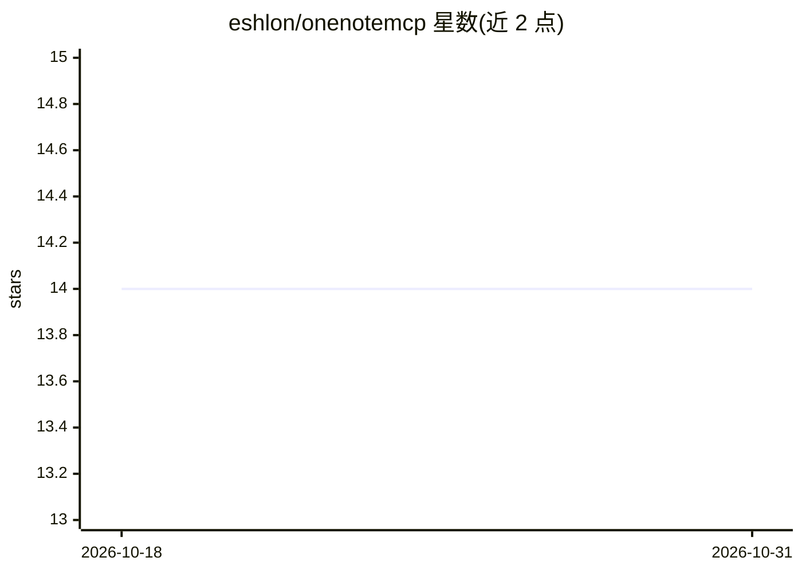

# eshlon/onenotemcp

⭐ 14 · JavaScript · MIT · 推送 2026-05-01 · [GitHub](https://github.com/eshlon/onenotemcp) · 个人维护

**让 AI 助手读写搜索 OneNote 笔记的 MCP 服务器**

基于 Node.js 的 Model Context Protocol 服务器，通过 Microsoft Graph API 使 Claude Desktop、Cursor 等 MCP 客户端中的 AI 助手能够读取、创建、编辑和搜索 OneNote 笔记本、分区与页面。提供约 12 个工具：列笔记本、按标题搜页、读取页面（text/html/summary 格式）、创建/更新/追加页面、查找替换、添加备注与 CSV 表格插入等。认证采用 Azure 设备码流程，令牌保存于本地 .access-token.txt；生产环境建议自建 Azure 应用注册，测试时可回退到 Graph Explorer 公共 Client ID。

## 筛选速览

| 维度 | 判定 | 备注 |
|---|---|---|
| AI 角色 | `ai-ecosystem` | LLM/agent 周边工具 |
| 许可风险 | `permissive` | MIT |
| 部署形态 | `library` | 以包/库形式分发 |
| 模型依赖 | — | README 未给出锁定关系 |
| 硬件要求 | — | 无带数字的原话,不猜 |
| 安装摩擦 | `low` | 无编译、无系统依赖或容器化 |
| 成熟度 | — | 结构信号不足 |

## 能力要点

- 通过 Microsoft Graph API 读写编辑 OneNote 笔记本/分区/页面
- 设备码流程认证，令牌本地存储供后续会话复用
- 12 个 MCP 工具：搜索、读取（text/html/summary）、创建、追加、查找替换、CSV 表格插入
- 输入校验采用 Zod schema

## 适用场景

- 在 Claude Desktop 或 Cursor 中用对话管理 OneNote 笔记
- 让 AI 按标题查找并总结 OneNote 页面内容
- 通过对话在 OneNote 页面中做查找替换或追加内容

## 场景标签

`知识库管理` · 领域:知识与检索

## 证据(README 行号)

> L5: The OneNote MCP Server is a powerful Model Context Protocol (MCP) server that enables AI language models (LLMs) like
> L89: You can connect this server to any MCP-compatible client, such as Claude Desktop or Cursor.

## 星数曲线

2026-10-18 14 → 2026-10-31 14（+0）

---
*卡片 v1 · prompt 1.4 · 生成 2026-10-31 · 置信度 high · 依据 README sha `d8dcb39a08e5` · [字段定义](../../DATASET.md)*
