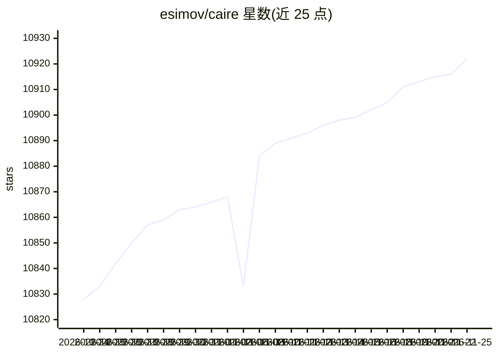

# esimov/caire

⭐ 10,922 · Go · MIT · 推送 2026-11-16 · [GitHub](https://github.com/esimov/caire) · 个人维护

**基于 seam carving 的内容感知图像缩放库/命令行工具**

以 Go 实现的内容感知图像缩放工具，依据 seam carving 论文生成能量图并逐条移除/插入低能量接缝，实现图像的收缩与放大。内置人脸检测（Pigo）与文本检测以避免人物和文字区域变形，支持保护/移除蒙版、GUI 实时预览、stdin/stdout 管道、目录并发处理、一键方形化与多输出格式。安装需 Go 环境，亦提供 Homebrew 与 snap 包。

## 筛选速览

| 维度 | 判定 | 备注 |
|---|---|---|
| AI 角色 | `ai-native` | 本体是模型或模型工具 |
| 许可风险 | `permissive` | MIT |
| 部署形态 | `library` | 以包/库形式分发 |
| 模型依赖 | — | README 未给出锁定关系 |
| 硬件要求 | — | 无带数字的原话,不猜 |
| 安装摩擦 | `low` | 无编译、无系统依赖或容器化 |
| 成熟度 | — | 结构信号不足 |

## 能力要点

- seam carving 算法支持双向收缩与放大缩放
- Pigo 人脸检测内嵌二进制，无需分类文件
- 文本检测（v1.6.0 起）与 Canny/Sobel 可调参数
- 支持管道、目录并发处理及保护/移除蒙版

## 适用场景

- 批量内容感知缩放图片目录而不裁掉人脸
- 管道方式集成到图像处理流水线（curl/stdin）
- 通过蒙版保护或强制移除图中特定区域
- 经 OpenFaaS 部署为 serverless 图像缩放函数

## 场景标签

`图像视频处理` · 领域:感知与多模态

## 证据(README 行号)

> L10: **Caire** is a content aware image resize library based on *Seam Carving for Content-Aware Image Resizing* paper.
> L13: * An energy map (edge detection) is generated from the provided image.
> L100: The library is capable to detect human faces prior resizing the images by using the lightweight Pigo (https://gith

## 星数曲线

2026-10-24 10,828 → 2026-11-25 10,922（+94）

---
*卡片 v1 · prompt 1.4 · 生成 2026-11-23 · 置信度 high · 依据 README sha `b42a1670e520` · [字段定义](../../DATASET.md)*
