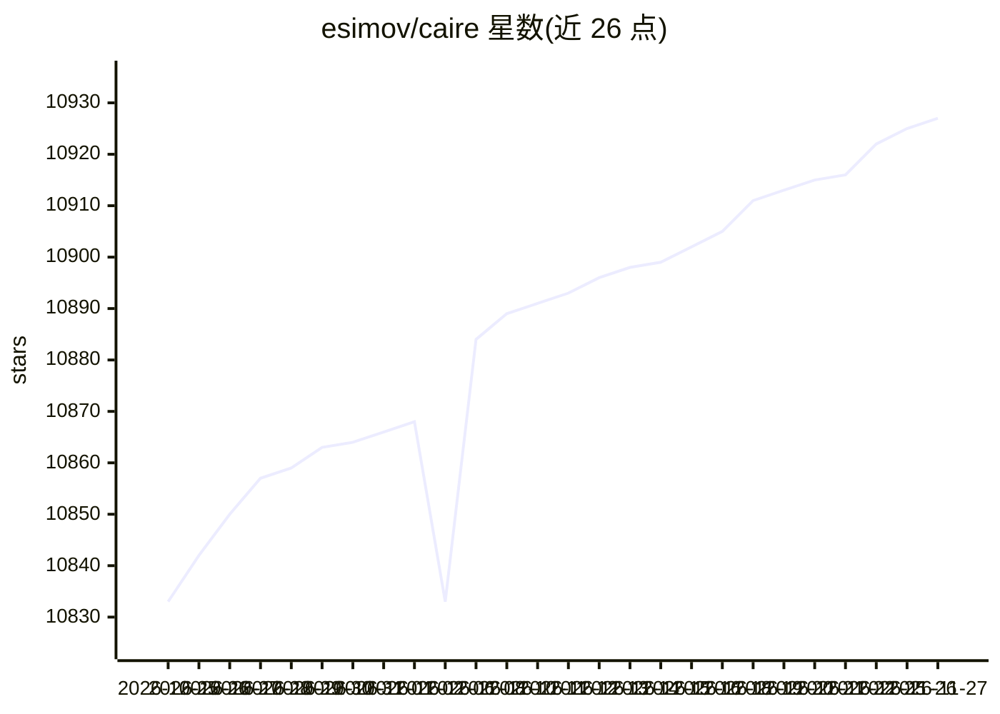

# esimov/caire

⭐ 10,927 · Go · MIT · 推送 2026-11-25 · [GitHub](https://github.com/esimov/caire) · 个人维护

**基于 seam carving 的内容感知图像缩放 CLI 工具与库**

Go 编写的内容感知图像缩放库，实现 Seam Carving 论文算法：通过 Sobel/Canny 边缘检测生成能量图，用动态规划寻找并移除低能量接缝，实现水平/垂直方向的收缩与放大。内置 Pigo 人脸检测避免人脸变形，v1.6.0 起支持文本区域检测，并提供保护/移除蒙版、按比例缩放、一键方形化、目录并发处理、stdin/stdout 管道等能力。通过 go install 或 Homebrew 安装，也可作为 OpenFaaS serverless 函数或 snap 运行。

## 筛选速览

| 维度 | 判定 | 备注 |
|---|---|---|
| AI 角色 | `ai-native` | 本体是模型或模型工具 |
| 许可风险 | `permissive` | MIT |
| 部署形态 | `library` | 以包/库形式分发 |
| 模型依赖 | — | README 未给出锁定关系 |
| 硬件要求 | — | 无带数字的原话,不猜 |
| 安装摩擦 | `low` | 无编译、无系统依赖或容器化 |
| 成熟度 | — | 结构信号不足 |

## 能力要点

- Seam carving 算法支持横向/纵向收缩与放大
- Pigo 人脸检测（分类文件已嵌入二进制）避免人脸变形
- 文本区域检测（-textDetect 特性开关，默认关闭）
- 保护蒙版与移除蒙版、目录并发处理、stdin/stdout 管道

## 适用场景

- 在不裁掉主体（人脸/文字）的前提下调整图片尺寸
- 批量并发处理目录中的图片到指定宽高
- 把图片一键缩放为正方形
- 通过管道或 URL 直接处理网络图片

## 场景标签

`图像视频处理` · 领域:感知与多模态

## 证据(README 行号)

> L10: **Caire** is a content aware image resize library based on *Seam Carving for Content-Aware Image Resizing* paper.
> L13: * An energy map (edge detection) is generated from the provided image.
> L100: The library is capable to detect human faces prior resizing the images by using the lightweight Pigo (https://gith

## 星数曲线

2026-10-25 10,833 → 2026-11-27 10,927（+94）

---
*卡片 v1 · prompt 1.4 · 生成 2026-11-26 · 置信度 high · 依据 README sha `82dfe8f9291f` · [字段定义](../../DATASET.md)*
