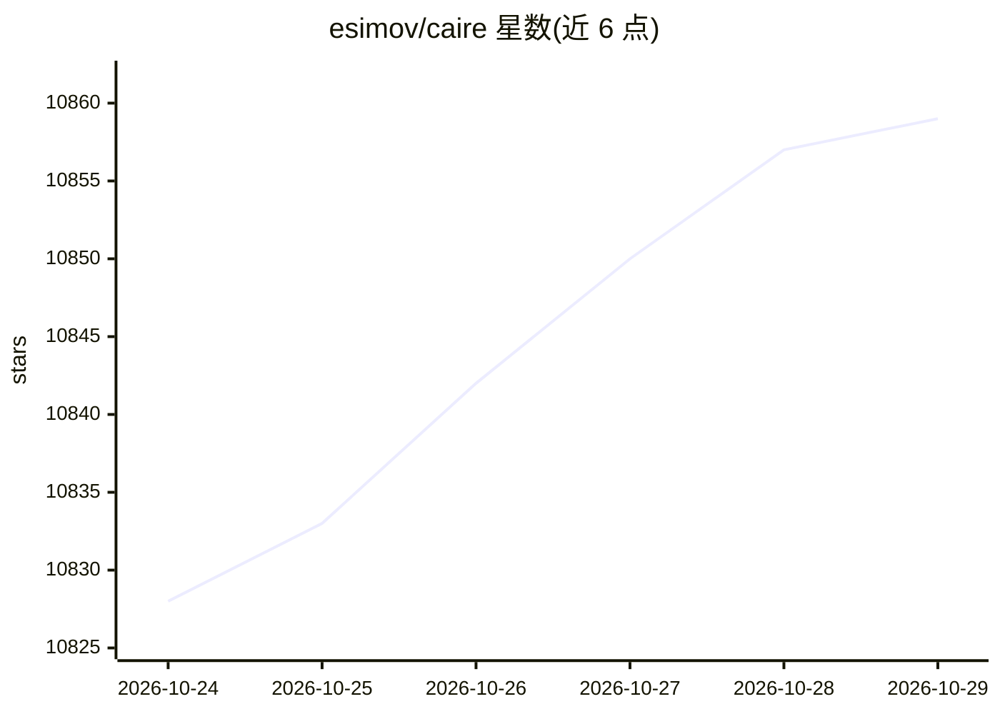

# esimov/caire

⭐ 10,859 · Go · MIT · 推送 2026-10-26 · [GitHub](https://github.com/esimov/caire) · 个人维护

**Go 编写的感知内容图像缩放库（Seam Carving），可保护人脸**

基于 Seam Carving 论文的图像内容感知缩放库与命令行工具：生成 Sobel 边缘检测能量图，用动态规划寻找低能量接缝并移除或扩展，实现纵向/横向缩放、按比例缩放、正方形化；内置 Pigo 人脸检测（分类器已嵌入二进制）避免人脸变形，支持保护/移除掩码、stdin/stdout 管道、目录并发处理与 GUI 预览。以 Go 库与 CLI 形式提供，可经 go install、Homebrew 或 snap 安装，另有 OpenFaaS serverless 集成。

## 筛选速览

| 维度 | 判定 | 备注 |
|---|---|---|
| AI 角色 | `ai-enhanced` | 去掉 AI 部分产品仍成立 |
| 许可风险 | `permissive` | MIT |
| 部署形态 | `library` | 以包/库形式分发 |
| 模型依赖 | — | README 未给出锁定关系 |
| 硬件要求 | — | 无带数字的原话,不猜 |
| 安装摩擦 | `low` | 无编译、无系统依赖或容器化 |
| 成熟度 | — | 结构信号不足 |

## 能力要点

- Seam Carving 内容感知缩放，支持缩小与放大、横纵双向
- 基于 Pigo 的人脸检测，避免缩放时人脸变形（分类器嵌入二进制）
- 支持保护掩码/移除掩码、stdin/stdout 管道与目录并发处理
- Gio GUI 实时预览，并可经 OpenFaaS/snap 部署

## 适用场景

- 批量调整图片尺寸且保留画面重点内容
- 缩放含人脸的照片时避免人脸变形
- 通过掩码指定必须保留或必须移除的画面区域

## 场景标签

`图像视频处理` · 领域:感知与多模态

## 证据(README 行号)

> L10: **Caire** is a content aware image resize library based on *Seam Carving for Content-Aware Image Resizing* paper.
> L94: The library is capable of detecting human faces prior resizing the images by using the lightweight Pigo (https://gi

## 星数曲线

2026-10-24 10,828 → 2026-10-29 10,859（+31）

---
*卡片 v1 · prompt 1.4 · 生成 2026-10-23 · 置信度 high · 依据 README sha `41dbf8c18234` · [字段定义](../../DATASET.md)*
