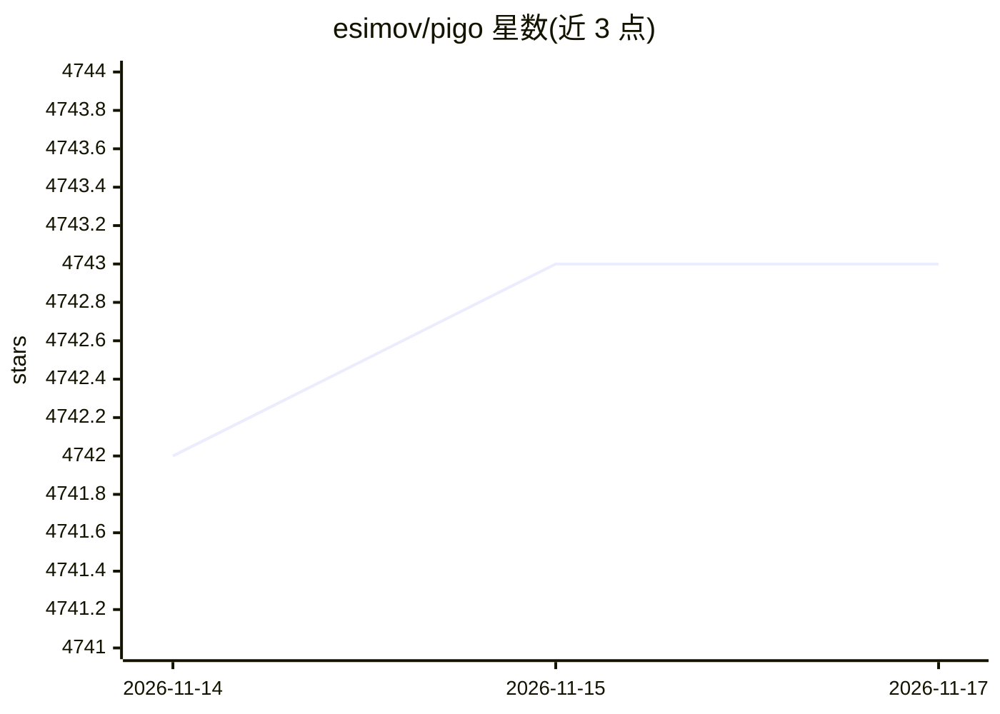

# esimov/pigo

⭐ 4,743 · Go · MIT · 推送 2026-11-16 · [GitHub](https://github.com/esimov/pigo) · 个人维护

**纯 Go 的人脸检测、瞳孔定位与面部关键点检测库**

基于 Pixel Intensity Comparison Object detection 论文实现的纯 Go 计算机视觉库，不依赖 OpenCV 等 C/C++ 库和 cgo，提供人脸检测（含平面内旋转人脸、戴眼镜人脸）、瞳孔/眼睛定位（基于随机树集成）和面部关键点检测（v1.3.0 起）。附带 CLI 工具，支持 stdin/stdout 管道和 JSON 坐标输出；v1.4.0 起移植到 WebAssembly，作者报告实时检测约 60 FPS。实时桌面演示需 Python+OpenCV 配合（因 Go 生态缺少跨平台摄像头访问库）。

## 筛选速览

| 维度 | 判定 | 备注 |
|---|---|---|
| AI 角色 | `ai-native` | 本体是模型或模型工具 |
| 许可风险 | `permissive` | MIT |
| 部署形态 | `library` | 以包/库形式分发 |
| 模型依赖 | — | README 未给出锁定关系 |
| 硬件要求 | — | 无带数字的原话,不猜 |
| 安装摩擦 | `low` | 无编译、无系统依赖或容器化 |
| 成熟度 | — | 结构信号不足 |

## 能力要点

- 纯 Go 实现，无需 OpenCV 或第三方模块
- 人脸检测、瞳孔/眼睛定位、面部关键点检测
- WebAssembly 支持，README 报告约 60 FPS 实时检测
- CLI 支持 stdin/stdout 管道与 JSON 检测坐标输出

## 适用场景

- 在 Go 项目中集成无需 cgo 的人脸检测
- 通过 CLI 批量处理图像并输出检测坐标
- 在浏览器中以 WASM 运行实时人脸检测

## 场景标签

`人脸识别` · 领域:感知与多模态

## 证据(README 行号)

> L9: Pigo is a pure Go face detection, pupil/eyes localization and facial landmark points detection library based on the 
> L25: - [x] The face detection is based on pixel intensity comparison encoded in the binary file tree structure

## 星数曲线

2026-11-14 4,742 → 2026-11-17 4,743（+1）

---
*卡片 v1 · prompt 1.4 · 生成 2026-11-17 · 置信度 high · 依据 README sha `a0903a3993c5` · [字段定义](../../DATASET.md)*
