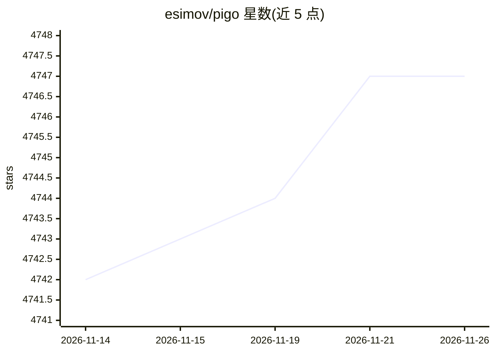

# esimov/pigo

⭐ 4,747 · Go · MIT · 推送 2026-11-24 · [GitHub](https://github.com/esimov/pigo) · 个人维护

**纯 Go 人脸检测库：检测人脸、瞳孔与面部关键点**

基于 Pixel Intensity Comparison-based Object detection 论文实现的纯 Go 库，提供人脸检测、瞳孔/眼睛定位（v1.2.0 起）与面部关键点检测（v1.3.0 起），v1.4.0 起支持 WASM 运行。不依赖 OpenCV 或第三方模块，级联文件直接嵌入二进制；提供 CLI 工具（支持 stdin/stdout 管道、JSON 输出、平面内旋转人脸检测），并可通过共享对象（SO/DLL）方式嵌入 Python 等语言。安装需 Go 环境或从 Releases 获取二进制，也可经 snapcraft 获取。

## 筛选速览

| 维度 | 判定 | 备注 |
|---|---|---|
| AI 角色 | `ai-native` | 本体是模型或模型工具 |
| 许可风险 | `permissive` | MIT |
| 部署形态 | `library` | 以包/库形式分发 |
| 模型依赖 | — | README 未给出锁定关系 |
| 硬件要求 | — | 无带数字的原话,不猜 |
| 安装摩擦 | `low` | 无编译、无系统依赖或容器化 |
| 成熟度 | — | 结构信号不足 |

## 能力要点

- 纯 Go 实现，无需安装 OpenCV 或第三方模块
- 级联文件嵌入二进制，检测前无需图像预处理或积分图计算
- 支持瞳孔/眼睛定位与面部关键点检测
- WASM 移植，浏览器内实时人脸检测

## 适用场景

- 在 Go 项目中做人脸与瞳孔检测且不引入 C 依赖
- 通过 WASM 在浏览器中运行人脸检测
- 命令行批量处理图片并输出检测坐标 JSON

## 场景标签

`人脸识别` · 领域:感知与多模态

## 证据(README 行号)

> L9: Pigo is a pure Go face detection, pupil/eyes localization and facial landmark points detection library based on the 
> L19: - [x] Does not require OpenCV or any 3rd party modules to be installed
> L26: - [x] Pupils/eyes localization

## 星数曲线

2026-11-14 4,742 → 2026-11-26 4,747（+5）

---
*卡片 v1 · prompt 1.4 · 生成 2026-11-26 · 置信度 high · 依据 README sha `4e385c93fbda` · [字段定义](../../DATASET.md)*
