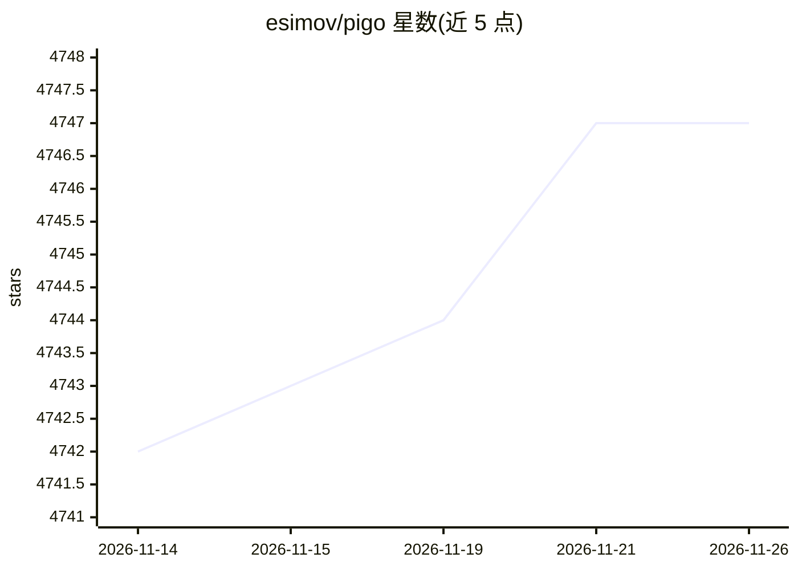

# esimov/pigo

⭐ 4,747 · Go · MIT · 推送 2026-11-24 · [GitHub](https://github.com/esimov/pigo) · 个人维护

**纯 Go 实现的人脸/瞳孔/面部关键点检测库**

基于像素强度比较目标检测论文实现的人脸检测库，提供人脸矩形/圆形标记、瞳孔/眼睛定位与面部关键点检测。不依赖 OpenCV 或第三方模块，检测前无需图像预处理，无需积分图、图像金字塔等数据结构，级联文件直接嵌入生成的二进制。支持实时检测、平面内旋转人脸检测、WebAssembly（~60 FPS）、作为共享库嵌入 Python 等支持 C 链接的语言，自带 CLI 工具，支持 stdin/stdout 管道与 JSON 输出。

## 筛选速览

| 维度 | 判定 | 备注 |
|---|---|---|
| AI 角色 | `ai-native` | 本体是模型或模型工具 |
| 许可风险 | `permissive` | MIT |
| 部署形态 | `library` | 以包/库形式分发 |
| 模型依赖 | — | README 未给出锁定关系 |
| 硬件要求 | — | 无带数字的原话,不猜 |
| 安装摩擦 | `low` | 无编译、无系统依赖或容器化 |
| 成熟度 | — | 结构信号不足 |

## 能力要点

- 纯 Go 实现，无需安装 OpenCV 或任何第三方模块
- 支持瞳孔/眼睛定位与面部关键点检测
- WebAssembly 支持，实时检测约 60 FPS
- 级联文件嵌入二进制，CLI 支持 JSON 输出与管道

## 适用场景

- 在 Go 项目中做人脸检测与瞳孔定位
- 浏览器端通过 WASM 运行实时人脸检测
- 用 Python 通过共享库调用检测能力

## 场景标签

`人脸识别` · 领域:感知与多模态

## 证据(README 行号)

> L9: Pigo is a pure Go face detection, pupil/eyes localization and facial landmark points detection library based on the 
> L63: Starting from version **v1.4.0** the library has been ported to **WASM**. This proves the library's real time face 

## 星数曲线

2026-11-14 4,742 → 2026-11-26 4,747（+5）

---
*卡片 v1 · prompt 1.4 · 生成 2026-11-24 · 置信度 high · 依据 README sha `5ec66c00dae5` · [字段定义](../../DATASET.md)*
