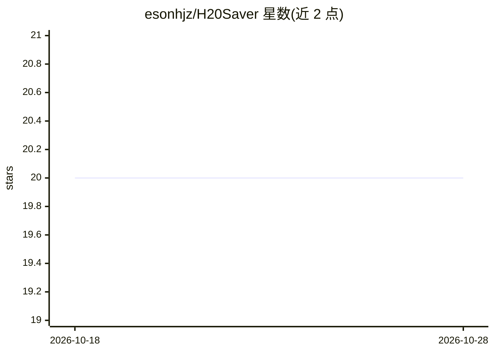

# esonhjz/H20Saver

⭐ 21 · Python · MIT · 推送 2026-07-30 · [GitHub](https://github.com/esonhjz/H20Saver) · 个人维护 · 中文 README

**溺水目标检测系统：基于 YOLO11x 训练的三分类检测模型**

基于 YOLO11x 微调的溺水目标检测项目，识别 drowning/swimming/out of water 三类目标，覆盖数据集分析、训练、评估与导出部署的完整流程。训练使用 14,111 张标注图像，采用类权重与 Focal loss 处理类别不均衡。验证集上 drowning 类 mAP50 为 0.924，out of water 类召回率较低（0.464，样本约 5,500 条较少）。模型可导出 ONNX 格式，权重托管于 Hugging Face，通过 requirements.txt 安装依赖后运行。

## 筛选速览

| 维度 | 判定 | 备注 |
|---|---|---|
| AI 角色 | `ai-native` | 本体是模型或模型工具 |
| 许可风险 | `permissive` | MIT |
| 部署形态 | `library` | 以包/库形式分发 |
| 模型依赖 | — | README 未给出锁定关系 |
| 硬件要求 | — | 无带数字的原话,不猜 |
| 安装摩擦 | `low` | 无编译、无系统依赖或容器化 |
| 成熟度 | — | 结构信号不足 |

## 能力要点

- 基于 YOLO11x 微调的三分类溺水检测模型（drowning/swimming/out of water）
- 14,111 张标注图像的数据集分析（类别分布、边界框尺寸）
- 验证集整体 mAP50 为 0.766，drowning 类 mAP50 为 0.924
- 支持导出 ONNX 格式用于多平台部署

## 适用场景

- 泳池或水域监控场景中检测溺水目标
- 溺水检测相关的研究与实验
- 复用或扩展已标注的溺水检测数据集与训练流程

## 场景标签

`目标检测` · 领域:感知与多模态

## 证据(README 行号)

> L7: This project aims to implement an efficient drowning target detection system, fine-tuned based on the YOLO11x model.
> L81:  - Pretrained Model: `yolo11x.pt`

## 星数曲线

2026-10-18 20 → 2026-10-28 20（+0）

---
*卡片 v1 · prompt 1.4 · 生成 2026-10-28 · 置信度 high · 依据 README sha `8ad4f2503970` · [字段定义](../../DATASET.md)*
