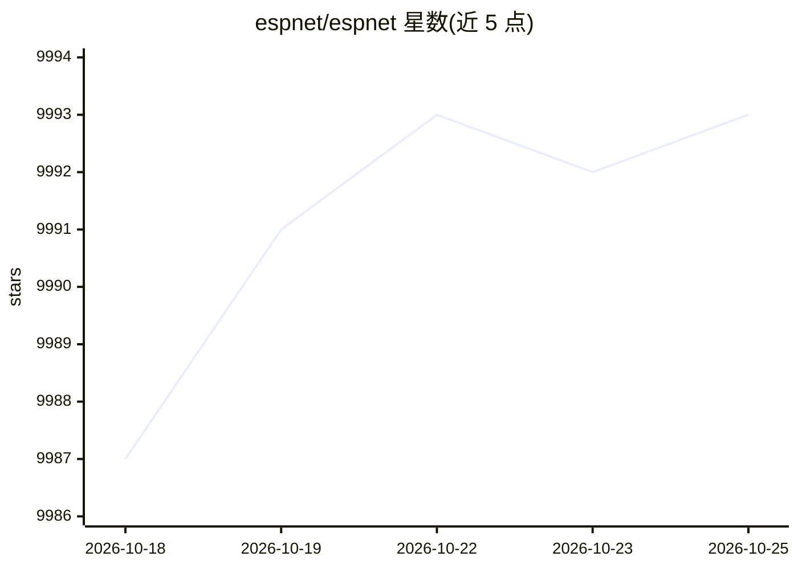

# espnet/espnet

⭐ 9,993 · Python · Apache-2.0 · 推送 2026-10-24 · [GitHub](https://github.com/espnet/espnet) · [官网](https://espnet.github.io/espnet/) · 组织维护

**端到端语音处理工具包：覆盖识别、合成、翻译、增强等任务**

基于 PyTorch 的语音处理工具包，覆盖 ASR、TTS、语音翻译、语音增强/分离、说话人分离、口语理解、歌声合成、语音语言模型等任务。提供 Kaldi 风格的可复现 recipe（从数据准备到评测，200+ 语料配方）与数百个 Hugging Face 预训练模型。使用方式包括 CLI、Python API、Docker、MCP server（供 Claude/Cursor 等 agent 调用）及 Colab notebook。支持 DDP/多节点/Slurm 训练。ESPnet1 已停止支持，需使用 ESPnet2/ESPnet3。

## 筛选速览

| 维度 | 判定 | 备注 |
|---|---|---|
| AI 角色 | `ai-native` | 本体是模型或模型工具 |
| 许可风险 | `permissive` | Apache-2.0 |
| 部署形态 | `self-host` | docker 或自建部署 |
| 模型依赖 | — | README 未给出锁定关系 |
| 硬件要求 | — | 无带数字的原话,不猜 |
| 安装摩擦 | `low` | 无编译、无系统依赖或容器化 |
| 成熟度 | — | 结构信号不足 |

## 能力要点

- 200+ 语料的 Kaldi 式可复现 recipe，覆盖 ASR/TTS/ST/SE/说话人等任务
- 数百个 Hugging Face 预训练模型，含多语言 OWSM 系列
- CLI/Python/Docker/MCP server 四种调用方式
- 支持 DDP、多节点、Slurm/MPI、DeepSpeed 的可扩展训练

## 适用场景

- 训练或微调自己的语音识别、合成或翻译模型
- 用预训练模型直接转录、翻译或合成音频
- 复现论文基线结果（LibriSpeech、Switchboard 等标准配方）
- 通过 MCP 让编程 agent 直接调用语音任务

## 场景标签

`语音识别` `语音合成` `模型训练` `微调` · 领域:内容生成

## 证据(README 行号)

> L20: ESPnet is an end-to-end speech processing toolkit built on PyTorch. It covers speech recognition, text-to-speech, s
> L126: |🗣️|**ASR** — speech recognition|`asr1`, `asr2`|Hybrid CTC/attention, Transducer, streaming, Conformer / E-Branchf
> L136: |📦|**Codec** — neural audio codecs|`codec1`|Discrete speech tokens for downstream tasks|

## 星数曲线

2026-10-18 9,987 → 2026-10-25 9,993（+6）

---
*卡片 v1 · prompt 1.4 · 生成 2026-10-20 · 置信度 high · 依据 README sha `28606c5417ce` · [字段定义](../../DATASET.md)*
