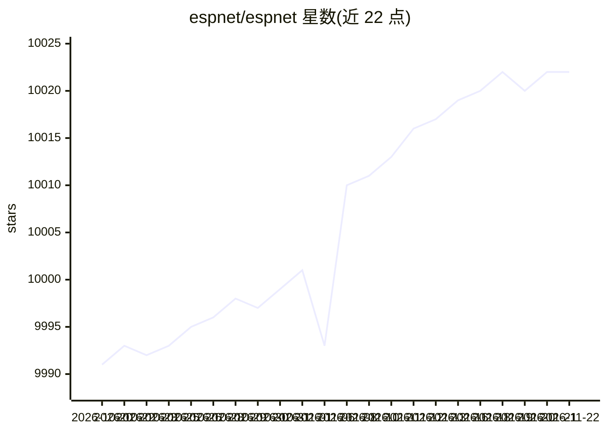

# espnet/espnet

⭐ 10,022 · Python · Apache-2.0 · 推送 2026-11-21 · [GitHub](https://github.com/espnet/espnet) · [官网](https://espnet.github.io/espnet/) · 组织维护

**端到端语音处理工具包：识别/合成/翻译等任务的训练与推理**

基于 PyTorch 的端到端语音处理工具包，覆盖语音识别、TTS、语音翻译、语音增强、说话人分离、歌声合成、语音语言模型等十余类任务。提供 Kaldi 风格的可复现 recipe（从数据准备到评测的 run.sh 流水线，200+ 语料），数百个预训练模型发布在 Hugging Face。可通过 pip 安装，CLI/Python/MCP 服务器三种调用方式，Docker 镜像支持推理。ESPnet1 已不再支持，需使用 ESPnet2 或 ESPnet3。

## 筛选速览

| 维度 | 判定 | 备注 |
|---|---|---|
| AI 角色 | `ai-native` | 本体是模型或模型工具 |
| 许可风险 | `permissive` | Apache-2.0 |
| 部署形态 | `self-host` | docker 或自建部署 |
| 模型依赖 | — | README 未给出锁定关系 |
| 硬件要求 | — | 无带数字的原话,不猜 |
| 安装摩擦 | `low` | 无编译、无系统依赖或容器化 |
| 成熟度 | — | 结构信号不足 |

## 能力要点

- 覆盖 ASR/TTS/ST/SE/SPK/DIAR 等 10+ 语音任务
- Kaldi 风格可复现 recipe，200+ 语料模板一条 run.sh 跑通
- 数百个预训练模型托管于 Hugging Face
- 提供 MCP 服务器供 Claude/Cursor 等 agent 调用语音任务

## 适用场景

- 训练或复现语音识别/TTS 等模型的实验
- 用预训练模型做转录、合成、增强推理
- 为 agent 挂载语音任务的 MCP 工具

## 场景标签

`语音识别` `语音合成` `模型训练` · 领域:内容生成

## 证据(README 行号)

> L20: ESPnet is an end-to-end speech processing toolkit built on PyTorch. It covers speech recognition, text-to-speech, s
> L126: |🗣️|**ASR** — speech recognition|`asr1`, `asr2`|Hybrid CTC/attention, Transducer, streaming, Conformer / E-Branchf

## 星数曲线

2026-10-20 9,991 → 2026-11-22 10,022（+31）

---
*卡片 v1 · prompt 1.4 · 生成 2026-11-22 · 置信度 high · 依据 README sha `bffd03943504` · [字段定义](../../DATASET.md)*
