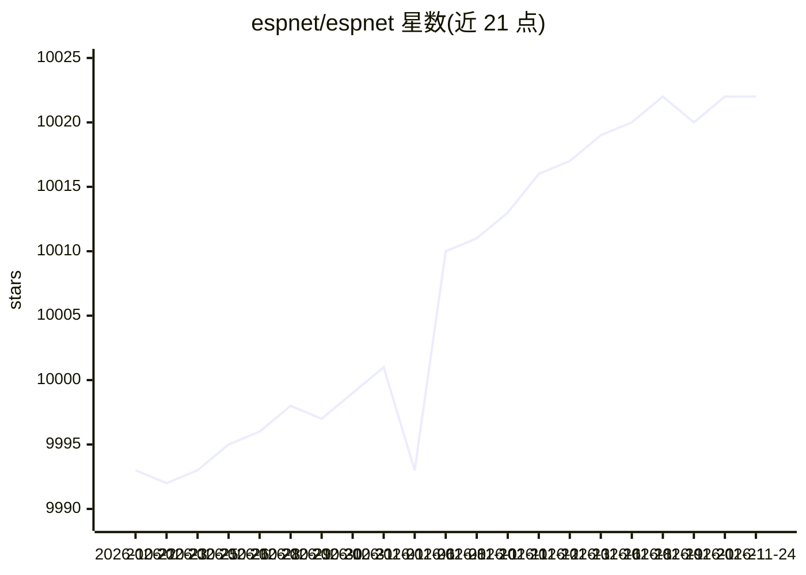

# espnet/espnet

⭐ 10,022 · Python · Apache-2.0 · 推送 2026-11-24 · [GitHub](https://github.com/espnet/espnet) · [官网](https://espnet.github.io/espnet/) · 组织维护

**面向开发者/科研的端到端语音处理工具包，覆盖识别/合成/翻译等任务**

基于 PyTorch 的端到端语音处理工具包，任务覆盖语音识别、TTS、语音翻译、语音增强、说话人分离、歌声合成、SSL、SpeechLM、神经音频编解码等，并为 200+ 语料提供 Kaldi 风格的可复现 recipe（数据准备到评分一条 run.sh）。提供 pip 安装的 CLI（transcribe/translate/synthesize/enhance 等）、Python API、MCP server 及 CPU/GPU Docker 镜像；数百个预训练模型发布在 Hugging Face。ESPnet1 已不再支持，需使用 ESPnet2/ESPnet3。

## 筛选速览

| 维度 | 判定 | 备注 |
|---|---|---|
| AI 角色 | `ai-native` | 本体是模型或模型工具 |
| 许可风险 | `permissive` | Apache-2.0 |
| 部署形态 | `self-host` | docker 或自建部署 |
| 模型依赖 | — | README 未给出锁定关系 |
| 硬件要求 | — | 无带数字的原话,不猜 |
| 安装摩擦 | `low` | 无编译、无系统依赖或容器化 |
| 成熟度 | — | 结构信号不足 |

## 能力要点

- 10+ 语音任务的统一 recipe 与训练接口（200+ 语料）
- CLI/Python/MCP server 三种调用方式，同一批模型
- CPU 与 GPU Docker 镜像可直接运行推理
- 数百个预训练模型发布于 Hugging Face，可打包为 Gradio Space

## 适用场景

- 用一条命令转录、翻译或增强音频文件
- 训练语音识别/合成模型并复现论文级基线结果
- 把语音任务作为工具接入 Claude/Cursor 等 agent
- 将训练好的模型打包发布为 Hugging Face Space 演示

## 场景标签

`语音识别` `语音合成` `模型训练` · 领域:内容生成

## 证据(README 行号)

> L20: ESPnet is an end-to-end speech processing toolkit built on PyTorch. It covers speech recognition, text-to-speech, s
> L73: espnet transcribe audio.wav                # detects the language
> L75: espnet synthesize "Hello from ESPnet" -o out.wav

## 星数曲线

2026-10-22 9,993 → 2026-11-24 10,022（+29）

---
*卡片 v1 · prompt 1.4 · 生成 2026-11-24 · 置信度 high · 依据 README sha `08cb0ee57d5e` · [字段定义](../../DATASET.md)*
