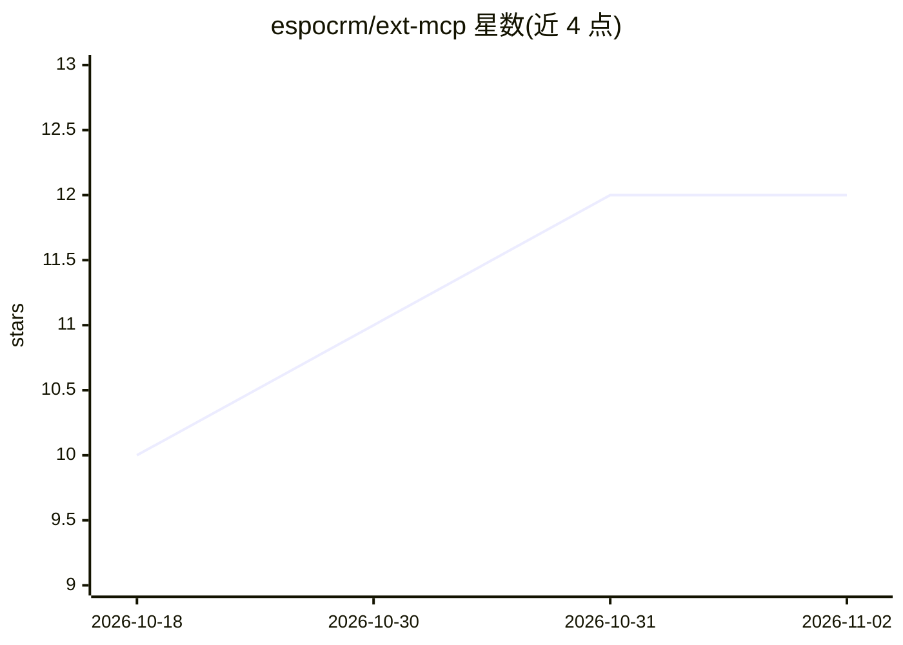

# espocrm/ext-mcp

⭐ 12 · PHP · AGPL-3.0 · 推送 2026-10-29 · [GitHub](https://github.com/espocrm/ext-mcp) · 组织维护

**让 EspoCRM 充当 MCP 服务器的官方扩展**

EspoCRM 官方扩展包：安装后使 EspoCRM 实例作为 MCP server 运行，供 AI agent 读取与操作 CRM 数据。管理员可创建多个 MCP endpoint，逐个配置暴露的 feature（Find/Read/Create/Update/Delete/Record Stream/Create Post），并按字段级白名单与用户角色控制工具可见性；工具暴露同时受用户访问权限约束。支持 API Key 与 OAuth 2.0（EspoCRM v10.1 起）认证，开发者可经 metadata 定义自定义工具与字段 schema。仅支持 MCP 协议版本 2026-07-28。以扩展包下载后安装到 EspoCRM 实例的方式交付。

## 筛选速览

| 维度 | 判定 | 备注 |
|---|---|---|
| AI 角色 | `ai-ecosystem` | LLM/agent 周边工具 |
| 许可风险 | `viral` | AGPL-3.0 |
| 部署形态 | `None` |  |
| 模型依赖 | — | README 未给出锁定关系 |
| 硬件要求 | — | 无带数字的原话,不猜 |
| 安装摩擦 | `low` | 无编译、无系统依赖或容器化 |
| 成熟度 | — | 结构信号不足 |

## 能力要点

- 多 MCP endpoint，每个作为独立 MCP server 运行
- 7 种 feature 类型映射为 MCP 工具（CRUD/流/发帖）
- 字段级白名单与用户权限双重控制工具暴露
- 开发者可自定义 feature 与字段级 schema provider

## 适用场景

- 让 AI agent 查询和更新 CRM 客户记录
- 为客服团队配置仅暴露少量工具的受限 MCP endpoint
- 在自托管 EspoCRM 上接入支持 MCP 的客户端

## 场景标签

 · 领域:企业软件/CRM

## 证据(README 行号)

> L3: An official extension.
> L5: With the extension installed, EspoCRM can act as an MCP server, allowing AI agents to access CRM data and perform op

## 星数曲线

2026-10-18 10 → 2026-11-02 12（+2）

---
*卡片 v1 · prompt 1.4 · 生成 2026-11-01 · 置信度 high · 依据 README sha `e0863c1aaa96` · [字段定义](../../DATASET.md)*
