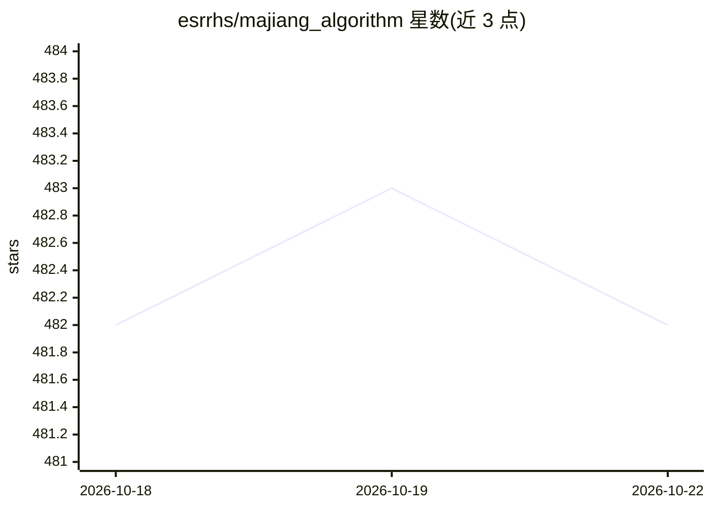

# esrrhs/majiang_algorithm

⭐ 482 · Go · MIT · 推送 2026-10-17 · [GitHub](https://github.com/esrrhs/majiang_algorithm) · [官网](http://majiang.esrrhs.xyz) · 个人维护 · 中文 README

**麻将算法库：胡牌检测、听牌计算与出牌决策，三种语言实现**

基于预计算查找表的麻将算法库，提供胡牌毫秒级检测（支持任意数量百搭牌）、听牌枚举、打分模型驱动的出牌/碰/杠决策。同一算法以 Java（发布至 Maven Central）、Go、C++17 三种纯算法库实现，共享 data/ 下的查找表，并通过 2000+ 固定种子对局在 CI 中回放断言三端行为一致（含比分位精确）。另含 FakeLua 实现的对战 Web 服务器与在线演示站点。限制：C++ 需自行 CMake 构建，服务器需预装 FakeLua。

## 筛选速览

| 维度 | 判定 | 备注 |
|---|---|---|
| AI 角色 | `ai-enhanced` | 去掉 AI 部分产品仍成立 |
| 许可风险 | `permissive` | MIT |
| 部署形态 | `None` |  |
| 模型依赖 | — | README 未给出锁定关系 |
| 硬件要求 | — | 无带数字的原话,不猜 |
| 安装摩擦 | `medium` | 含编译或系统依赖之一 |
| 成熟度 | — | 结构信号不足 |

## 能力要点

- 胡牌/听牌毫秒级检测，支持任意数量百搭牌
- Java/Go/C++ 三实现共享查找表，CI 回放 2000+ 固定对局保证行为一致
- 打分模型驱动的出牌/碰/杠 AI 决策
- FakeLua Web 对战服务器，查表存于 sqlite，稳态内存约 29 MB

## 适用场景

- 麻将游戏开发中集成胡牌与听牌判定
- 为对战机器人提供出牌与碰杠决策
- 研究跨语言算法行为一致性的工程实践

## 场景标签

 · 领域:游戏算法/棋牌

## 证据(README 行号)

> L9: - **Win detection**: Millisecond-level check for winning hands, supports any number of wildcard tiles
> L11: - **AI discard**: Score-model-driven auto decision for discarding, ponging, and konging

## 星数曲线

2026-10-18 482 → 2026-10-22 482（+0）

---
*卡片 v1 · prompt 1.4 · 生成 2026-10-21 · 置信度 mid · 依据 README sha `01399542b61e` · [字段定义](../../DATASET.md)*
