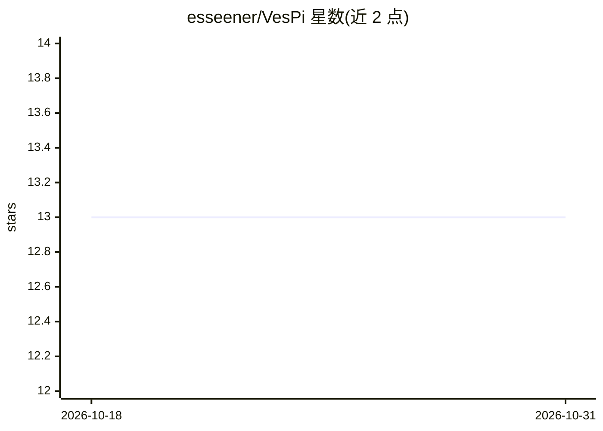

# esseener/VesPi

⭐ 13 · TypeScript · Apache-2.0 · 推送 2026-09-27 · [GitHub](https://github.com/esseener/VesPi) · [官网](https://esseener.github.io/VesPi/) · 个人维护 · 中文 README

**Windows 用户在桌面终端中运行 OMP 编码代理的外壳**

Oh My Pi（OMP）的 Windows 桌面外壳：主交互面为内嵌 PTY 运行 `omp --profile vespi` TUI，GUI 只承担多工作区窗口管理、会话索引、设置写入（主题/符号/思考等级/模型，合并写入 config.yml）与中文显示层（等宽替换翻译 TUI 输出，非官方本地化）。内核 omp.exe（18.3.2）随安装包交付，不需预装 Node/Bun。安装包未做代码签名，附 SHA256 校验。给使用 OMP 编码代理的用户提供桌面入口。

## 筛选速览

| 维度 | 判定 | 备注 |
|---|---|---|
| AI 角色 | `ai-ecosystem` | LLM/agent 周边工具 |
| 许可风险 | `permissive` | Apache-2.0 |
| 部署形态 | `desktop` | 安装包/桌面程序 |
| 模型依赖 | — | README 未给出锁定关系 |
| 硬件要求 | — | 无带数字的原话,不猜 |
| 安装摩擦 | `low` | 无编译、无系统依赖或容器化 |
| 成熟度 | — | 结构信号不足 |

## 能力要点

- 完整 PTY 内嵌 OMP TUI，工具/子代理/斜杠命令由 TUI 提供
- GUI 设置合并写入 OMP profile（主题、思考等级、模型等）
- 输出流上的中文显示层（等宽替换、词边界匹配）
- 内核随安装包交付（omp.exe 18.3.2），无需预装运行时

## 适用场景

- 在 Windows 桌面上以多工作区方式使用 OMP 编码代理
- 通过 GUI 管理会话与 OMP 配置，实际交互在终端 TUI 完成
- 以中文界面阅读 OMP TUI 输出

## 场景标签

`编码 Agent` · 领域:编码与开发

## 证据(README 行号)

> L21: **VesPi** 是 **Oh My Pi（OMP）** 的 Windows 桌面外壳。
> L29: |主交互面|终端内嵌 `omp --profile vespi` TUI（完整能力）|
> L36: **OMP 是能力真源。** 工具、子代理、会话、斜杠命令全部由 TUI 提供；VesPi 的按钮

## 星数曲线

2026-10-18 13 → 2026-10-31 13（+0）

---
*卡片 v1 · prompt 1.4 · 生成 2026-10-31 · 置信度 mid · 依据 README sha `ed962b558647` · [字段定义](../../DATASET.md)*
