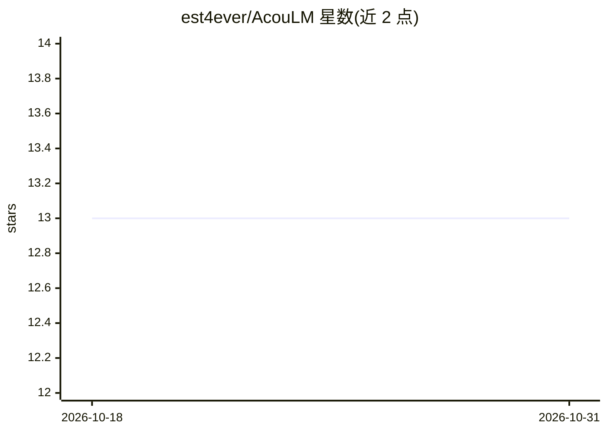

# est4ever/AcouLM

⭐ 13 · C++ · MIT · 推送 2026-08-24 · [GitHub](https://github.com/est4ever/AcouLM) · [官网](https://est4ever.github.io/AcouLM/) · 个人维护

**本地语言模型运行栈：在自己 PC 上加载模型并浏览器/终端对话**

面向终端用户的本地 LLM 运行环境：内置 OpenVINO 引擎加载用户自备的 OpenVINO IR 或 GGUF 模型，在 127.0.0.1 启动 API（端口 8000）与 Web 控制面板（端口 5173），支持 CPU/GPU/Intel NPU 推理，也可转发至外部 Ollama/llama.cpp 服务；不含模型权重，需用户提供。Windows 10/11 x64 为主要路径，提供 release zip 与 PowerShell 安装脚本，Linux/CUDA 路径为开发中。

## 筛选速览

| 维度 | 判定 | 备注 |
|---|---|---|
| AI 角色 | `ai-ecosystem` | LLM/agent 周边工具 |
| 许可风险 | `permissive` | MIT |
| 部署形态 | `None` |  |
| 模型依赖 | local-ok | 支持本地模型 |
| 硬件要求 | — | 无带数字的原话,不猜 |
| 安装摩擦 | `medium` | 含编译或系统依赖之一 |
| 成熟度 | `idea` | |

## 能力要点

- 内置 OpenVINO 引擎，支持 CPU/GPU/Intel NPU 推理
- 可转发至外部 Ollama / llama.cpp 后端
- 本地 API + Web 控制面板 + PowerShell 终端聊天三种入口
- 仅绑定 127.0.0.1，不向外部服务器发送数据

## 适用场景

- 在自己电脑上运行本地语言模型并对话
- 不依赖云服务地使用 ChatGPT 式聊天界面
- 选择 CPU/GPU/NPU 或外部后端运行自备模型

## 场景标签

`推理引擎` `聊天机器人` · 领域:对话与助手

## 证据(README 行号)

> L7: AcouLM runs **your own** language model on **your PC** — like a local ChatGPT stack you control. It is not a cloud s
> L15: |**Backend API** (`http://127.0.0.1:8000/v1`)|Loads the model and runs generation. Uses the built-in OpenVINO engin
> L84: |**Built-in**|AcouLM’s own OpenVINO runner in the zip — uses CPU, GPU, or Intel NPU on your machine.|

## 星数曲线

2026-10-18 13 → 2026-10-31 13（+0）

---
*卡片 v1 · prompt 1.4 · 生成 2026-10-31 · 置信度 high · 依据 README sha `0e867dd67d51` · [字段定义](../../DATASET.md)*
