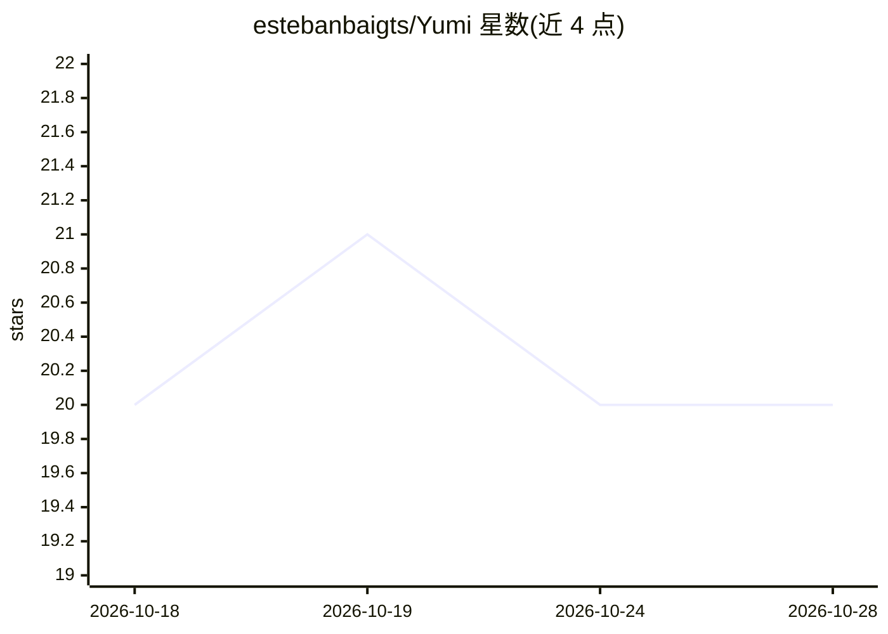

# estebanbaigts/Yumi

⭐ 20 · Swift · MIT · 推送 2026-10-15 · [GitHub](https://github.com/estebanbaigts/Yumi) · [官网](https://estebanbaigts.github.io/Yumi/) · 个人维护

**驻留 Mac 刘海区的 AI 伴侣应用：先请示后行动**

面向 macOS 用户的刘海区（notch）AI 助手应用：以自然语言完成提醒、日历事件、笔记、Notion 任务、专注计时等小动作。每次修改前展示具体变更并等待用户点击确认，执行后核验结果是否真实发生。权限经由单一检查点管理，外部服务每次询问，无账号无遥测。默认使用 Apple 端侧模型或无 AI 的简单模式，可接入 Claude Code、Anthropic/OpenAI/Gemini key 或 Ollama；另在刘海区展示 Claude Code 会话进度与审批。Swift 6/SwiftUI 构建，无第三方依赖，要求 macOS 15+。

## 筛选速览

| 维度 | 判定 | 备注 |
|---|---|---|
| AI 角色 | `ai-native` | 本体是模型或模型工具 |
| 许可风险 | `permissive` | MIT |
| 部署形态 | `desktop` | 安装包/桌面程序 |
| 模型依赖 | locked-api |  |
| 硬件要求 | — | 无带数字的原话,不猜 |
| 安装摩擦 | `medium` | 含编译或系统依赖之一 |
| 成熟度 | `idea` | |

## 能力要点

- 所有修改动作先展示并等用户点击确认，事后核验结果
- 默认 Apple 端侧模型或简单模式，无账号无遥测，本地优先
- 刘海区实时展示 Claude Code 会话进度并直接审批 Allow/Always/Deny
- 可切换引擎：Claude Code、Anthropic、OpenAI、Gemini、Ollama

## 适用场景

- 用一句话添加提醒、日历事件或创建笔记，确认后自动核验
- 在不离开当前工作的状态下审批 Claude Code 的权限请求
- 在刘海区查看当日日程、提醒、邮件、GitHub 与音乐等模块卡片

## 场景标签

`AI 助手` · 领域:对话与助手

## 证据(README 行号)

> L3:  The little AI in your notch that asks before it acts.
> L23: **Small actions. Real results.** You ask in plain words, in the notch. Every action below exists in the app today.
> L45: **Always asks first.** Before anything changes, he shows you exactly what he will do (the file and its content, the

## 星数曲线

2026-10-18 20 → 2026-10-28 20（+0）

---
*卡片 v1 · prompt 1.4 · 生成 2026-10-28 · 置信度 high · 依据 README sha `befcd61b9b1e` · [字段定义](../../DATASET.md)*
