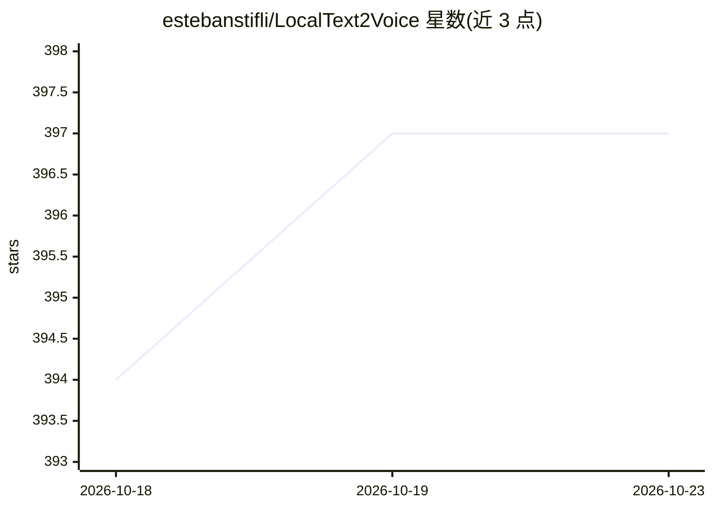

# estebanstifli/LocalText2Voice

⭐ 397 · Python · MIT · 推送 2026-10-08 · [GitHub](https://github.com/estebanstifli/LocalText2Voice) · [官网](https://andromedanova.com/localtext2voice.html) · 个人维护

**桌面应用：把文本制作为有声书、播客与视频，支持本地离线运行**

免费开源（MIT）的 Windows/Linux 桌面应用，面向长篇音频与视频制作：导入或撰写文本，生成分段配音，人工审校，混音，再经 Video Storyboard（Beta）规划场景、生成图像/视频并渲染 MP4。支持 Piper、Kokoro、Chatterbox、Qwen3 TTS、IndexTTS-2.5 等本地 TTS 引擎，可完全离线运行；OpenAI/ElevenLabs/Gemini/Azure 等云端 API 为可选。2.2.0 增加参考录音声音克隆与八种情感预设。视频部分仍属 Beta，官方说明生成内容需人工审校。提供 Windows 安装包，Linux 需从源码运行（Python 3.10+、FFmpeg），macOS 未支持。

## 筛选速览

| 维度 | 判定 | 备注 |
|---|---|---|
| AI 角色 | `ai-native` | 本体是模型或模型工具 |
| 许可风险 | `permissive` | MIT |
| 部署形态 | `desktop` | 安装包/桌面程序 |
| 模型依赖 | — | README 未给出锁定关系 |
| 硬件要求 | `gpu-8g` | |
| 安装摩擦 | `medium` | 含编译或系统依赖之一 |
| 成熟度 | `idea` | |

## 能力要点

- 本地引擎 Piper/Kokoro/Chatterbox/Qwen3 TTS/IndexTTS-2.5 可离线配音，云端 API 可选
- 声音克隆与八种情感预设（IndexTTS-2.5，含 CUDA/BF16 推理）
- Video Storyboard（Beta）：场景分析、图像/视频生成、渲染长篇 MP4
- 本地 MCP 自动化整个 Storyboard 工作流，共 76 个工具

## 适用场景

- 把书籍、讲义、文章制作成有声书或播客
- 从脚本生成纪录片、教学视频或动画短片
- 全程本地离线配音，数据不出本机
- 用 AI 声音克隆和情感标记制作多角色朗读

## 场景标签

`语音合成` `视频生成` `图像生成` `工作流自动化` · 领域:效率与自动化

## 证据(README 行号)

> L22: LocalText2Voice is a free desktop app for long-form AI voice and video production. It can run fully local and offli
> L24: The workflow is designed for long projects: import or write a script, generate narration, review and correct segmen

## 星数曲线

2026-10-18 394 → 2026-10-23 397（+3）

---
*卡片 v1 · prompt 1.4 · 生成 2026-10-22 · 置信度 mid · 依据 README sha `de1fd9dcd153` · [字段定义](../../DATASET.md)*
