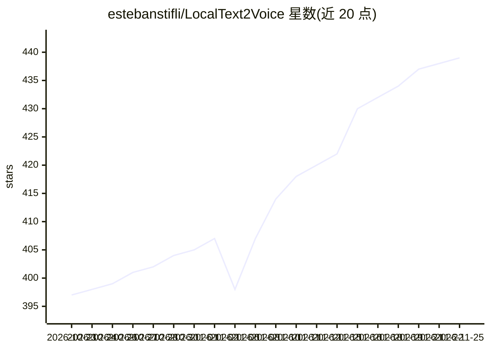

# estebanstifli/LocalText2Voice

⭐ 439 · Python · MIT · 推送 2026-11-17 · [GitHub](https://github.com/estebanstifli/LocalText2Voice) · [官网](https://andromedanova.com/localtext2voice.html) · 个人维护

**本地/云端 TTS 的长音频与视频内容生成桌面应用**

面向内容创作者的桌面应用（Python + PySide6）：导入或撰写脚本后生成长篇旁白，分段审校，混合音频，并通过 Video Storyboard 规划场景、生成图像与视频片段、渲染长篇 MP4，产出有声书、播客、纪录片等。本地引擎（Piper、Kokoro、Chatterbox、Qwen3 TTS、IndexTTS-2.5 及可选 audio.cpp 模型）可完全离线运行；OpenAI、ElevenLabs 等云 API 为可选项。Windows 提供签名安装包，Linux 从源码运行，macOS 未受支持。

## 筛选速览

| 维度 | 判定 | 备注 |
|---|---|---|
| AI 角色 | `ai-native` | 本体是模型或模型工具 |
| 许可风险 | `permissive` | MIT |
| 部署形态 | `desktop` | 安装包/桌面程序 |
| 模型依赖 | — | README 未给出锁定关系 |
| 硬件要求 | `gpu-8g` | |
| 安装摩擦 | `medium` | 含编译或系统依赖之一 |
| 成熟度 | — | 结构信号不足 |

## 能力要点

- 支持 Piper/Kokoro/Chatterbox/Qwen3 TTS/IndexTTS-2.5 等本地 TTS 引擎，可离线运行
- 可选 audio.cpp 原生运行时加载 Higgs/Fish/Breeze/VoxCPM GGUF 模型，支持 CPU/CUDA/Vulkan
- IndexTTS 语音克隆与八种情绪预设，支持分段级文本与参数编辑、中断续跑
- Video Storyboard 支持场景分析、图像生成、批量视频生成与 MP4 渲染（Beta），可接 ComfyUI/Runpod

## 适用场景

- 把书籍或课程文本转成有声书与播客旁白
- 在离线环境下生成语音，数据留在本机
- 制作带旁白与 AI 图像的纪录片或动画故事视频
- 通过 MCP 集成调用本地 TTS 引擎生成语音

## 场景标签

`语音合成` `视频生成` `图像生成` · 领域:内容生成

## 证据(README 行号)

> L22: LocalText2Voice is a free desktop app for long-form AI voice and video production. It can run fully local and offli
> L24: The workflow is designed for long projects: import or write a script, generate narration, review and correct segmen
> L6:  Turn books, lessons, articles, notes, and scripts into audiobooks, podcasts, documentaries, films, and animated vid

## 星数曲线

2026-10-23 397 → 2026-11-25 439（+42）

---
*卡片 v1 · prompt 1.4 · 生成 2026-11-25 · 置信度 mid · 依据 README sha `afefc7447cc9` · [字段定义](../../DATASET.md)*
