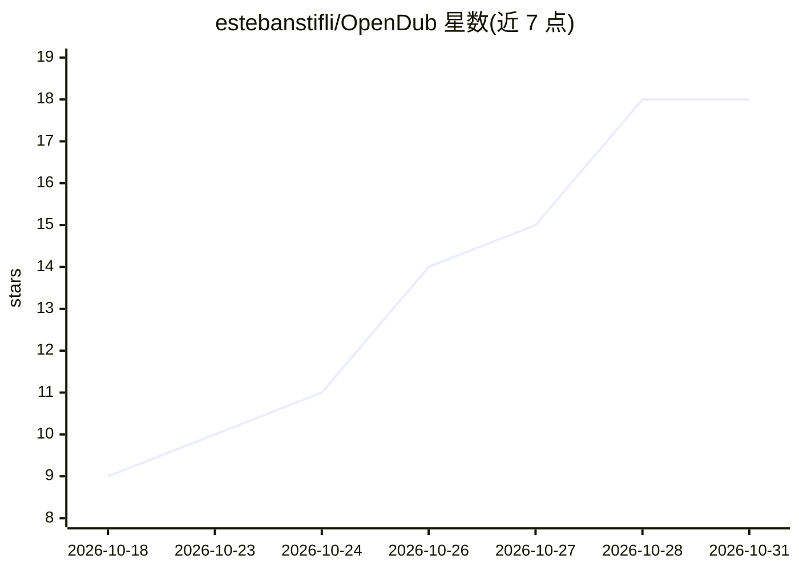

# estebanstifli/OpenDub

⭐ 18 · C# · MIT · 推送 2026-10-10 · [GitHub](https://github.com/estebanstifli/OpenDub) · [官网](https://www.youtube.com/watch?v=iYkr_BjH9cE) · 个人维护

**本地 AI 视频配音工作室：分离、转写、翻译与克隆配音**

面向桌面用户的本地视频翻译配音应用：将对话从音乐音效中分离，做说话人分离、转写、强制对齐，经 llama.cpp 运行 Qwen3 4B 翻译（亦可接本地 Ollama），再用 IndexTTS2.5 以声音与情感参考生成配音，支持时间线编辑、逐句预览与重新生成，导出 MP4/MKV/音频或剪辑包。提供 Windows/Linux/macOS 预构建包，含推理工具、FFmpeg 与 VLC，模型约 8 GiB 首次下载后离线运行。自称早期预览版，macOS 包未签名，配音输出支持中英日西阿五种语言。

## 筛选速览

| 维度 | 判定 | 备注 |
|---|---|---|
| AI 角色 | `ai-native` | 本体是模型或模型工具 |
| 许可风险 | `permissive` | MIT |
| 部署形态 | `desktop` | 安装包/桌面程序 |
| 模型依赖 | local-ok | 支持本地模型 |
| 硬件要求 | `gpu-8g` | |
| 安装摩擦 | `medium` | 含编译或系统依赖之一 |
| 成熟度 | `idea` | |

## 能力要点

- 本地全流程管线：分离/转写/说话人分离/翻译/语音生成
- 说话人专属声音参考与情感条件化合成
- llama.cpp 运行 Qwen3 4B 翻译，或接入本地 Ollama
- Windows/Linux/macOS 预构建包，含 FFmpeg/VLC，无需另装 .NET 或 Python

## 适用场景

- 把外语视频翻译并配音成自己的声音
- 在时间线上逐句校对译文并重新生成语音
- 分离对白与背景音乐后只替换人声轨
- 导出配音视频或音频、字幕等剪辑包

## 场景标签

`语音合成` `语音识别` · 领域:内容生成

## 证据(README 行号)

> L15: OpenDub is a desktop studio for translating and dubbing videos with local AI. Separate dialogue from music and effe
> L79: - **Local translation choices:** bundled llama.cpp with Qwen3 4B Q4_K_M, or models available through a local Ollama
> L119: |Translation|Qwen3 4B Q4_K_M via llama.cpp|Translate dialogue; local Ollama is also supported.|

## 星数曲线

2026-10-18 9 → 2026-10-31 18（+9）

---
*卡片 v1 · prompt 1.4 · 生成 2026-10-29 · 置信度 high · 依据 README sha `6403ffb0b00b` · [字段定义](../../DATASET.md)*
